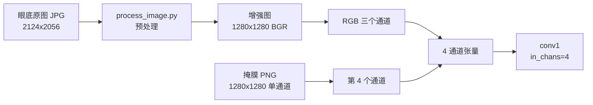
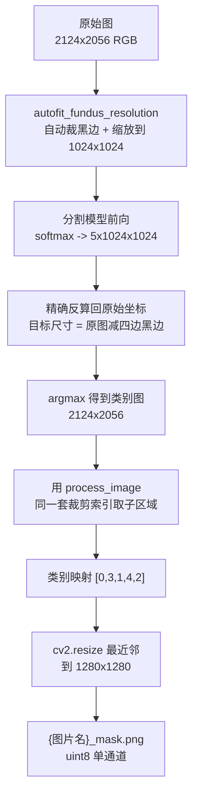

# SMVDR 复现操作手册

对应论文：*Like an Ophthalmologist: Dynamic Selection Driven Multi-View Learning for Diabetic Retinopathy Grading*（AAAI 2025）
代码仓库：`D:\github-repository\SMVDR`

本手册的每条命令都可以直接复制粘贴执行，每条后面写出预期输出。命令按顺序执行即可。

---

## 目录

1. [准备](#1-准备)
2. [装 PyTorch](#2-装-pytorch)
3. [装其余依赖](#3-装其余依赖)
4. [验证环境](#4-验证环境)
5. [放权重](#5-放权重)
6. [掩膜是什么，从哪里来](#6-掩膜是什么从哪里来)
7. [下载官方数据](#7-下载官方数据)
8. [组装运行目录](#8-组装运行目录)
9. [跑测试](#9-跑测试)
10. [跑训练](#10-跑训练)
11. [本机能做到哪一步](#11-本机能做到哪一步)
12. [已知的源码行为](#12-已知的源码行为)
13. [常见问题](#13-常见问题)

---

## 1. 准备

### 1.1 本机情况

| 项目 | 值 |
| --- | --- |
| GPU | NVIDIA GeForce RTX 4060 Laptop GPU |
| 显存 | 8188 MiB |
| 计算能力 | 8.9 |
| 驱动版本 | 617.14 |
| CPU | 12th Gen Intel Core i7-12650H，10 核 16 线程 |
| 内存 | 15.7 GB |
| D 盘空闲 | 214.6 GB |
| 系统代码页 | 936 |

论文用的是一张 RTX 3090（24 GB 显存）。本机显存只有它的三分之一，这决定了能做哪些步骤，见第 11 节。

### 1.2 解释器

PATH 上的 `python` 是 `C:\Users\29602\AppData\Local\Programs\Python\Python312\python.exe`（3.12.2）。**不要用它执行本项目的任何命令**，因为本项目依赖的 pandas 1.5.3 没有 3.12 版本的 wheel。

本项目用 conda 环境 `smvdr`（Python 3.11.9），位于 `D:\ProgramData\anaconda3\envs\smvdr`。

这台机器从未执行过 `conda init`，所以 `conda activate smvdr` 会报错：

```
CondaError: Run 'conda init' before 'conda activate'
```

因此下面所有命令都用解释器的绝对路径，不依赖 `conda activate`。

每开一个新的 PowerShell 窗口，先执行这一行：

```powershell
$PY = 'D:\ProgramData\anaconda3\envs\smvdr\python.exe'
```

确认一下它的版本：

```powershell
& $PY -c "import sys; print(sys.executable); print(sys.version)"
```

预期：

```
D:\ProgramData\anaconda3\envs\smvdr\python.exe
3.11.9 | packaged by conda-forge | (main, Apr 19 2024, 18:27:10) [MSC v.1938 64 bit (AMD64)]
```

如果第二行不是 3.11.9，说明环境不对，回到本节重设 `$PY`。

### 1.3 网络情况

这台机器的情况（决定了下面每条下载命令怎么写）：

| 主机 | 直连 | 说明 |
| --- | --- | --- |
| `pypi.org`、`files.pythonhosted.org` | 通 | 装普通依赖走这里 |
| `pypi.tuna.tsinghua.edu.cn` | 通 | 备用镜像 |
| `mirrors.aliyun.com` | 通 | PyTorch wheel 从这里取 |
| `github.com`、`raw.githubusercontent.com`、`codeload.github.com` | 通，偶尔被重置 | 下载数据与装 git 包用，脚本里已带自动重试；被重置时可以给 git 或 pip 加代理 `http://127.0.0.1:7890` |
| `download.pytorch.org` | **不通**（DNS 都解析不了） | 官方 PyTorch 下载站，必须换镜像 |
| `drive.usercontent.google.com`、`drive.google.com`、`www.googleapis.com` | **不通** | 403 或超时。SMVDR 官方权重已经下载好了；PyPI 版 `fundus_lesions_toolkit` 的分割权重放在这里，所以那个版本不能用，见 6.5 节 |
| `huggingface.co` | **Python 侧不通**（DNS 解析不了） | 分割权重所在。PowerShell 的 `Invoke-WebRequest` 能通是因为走了系统代理，Python 的 `urllib` 不走 |
| `hf-mirror.com` | 通 | HuggingFace 镜像，`generate_masks.py` 通过 `HF_ENDPOINT` 指向它 |

系统里配了代理 `HKCU\Software\Microsoft\Windows\CurrentVersion\Internet Settings` 的 `ProxyServer = 127.0.0.1:7890`、`ProxyEnable = 1`。PowerShell 的 `Invoke-WebRequest` 会自动用它；`pip` 和 Python 的 `urllib` 不会自动用它。

---

## 2. 装 PyTorch

PyTorch 必须从 cu121 索引装，不能用 PyPI 上的默认版本（那是 CPU 版本，装完 `torch.cuda.is_available()` 会返回 `False`）。官方索引 `download.pytorch.org` 在这台机器上解析不了域名，因此走阿里云镜像，文件完全相同。

```powershell
& $PY -m pip install 'https://mirrors.aliyun.com/pytorch-wheels/cu121/torch-2.4.1%2Bcu121-cp311-cp311-win_amd64.whl'
```

要下载约 2.33 GB，慢是正常的。预期最后一行形如：

```
Successfully installed torch-2.4.1+cu121 filelock-3.20.0 fsspec-2025.9.0 jinja2-3.1.6 networkx-3.5 sympy-1.14.0 typing-extensions-4.15.0
```

```powershell
& $PY -m pip install 'https://mirrors.aliyun.com/pytorch-wheels/cu121/torchvision-0.19.1%2Bcu121-cp311-cp311-win_amd64.whl'
```

预期：

```
Successfully installed torchvision-0.19.1+cu121
```

### 版本选择的依据

| 选择 | 依据 |
| --- | --- |
| `cp311` | 文件名里的 `cp311` 表示只适用于 CPython 3.11。用 3.12 的解释器装会报 `ERROR: torch-2.4.1+cu121-cp311-cp311-win_amd64.whl is not a supported wheel on this platform.` |
| `2.4.1` 而不是更新版本 | `test.py:181` 是 `torch.load(MODELPATH, map_location=device)`。torch 2.6 起 `weights_only` 默认改为 `True`，会拒绝反序列化权重里的自定义类。停在 2.4.1 可以保持原行为 |
| `cu121` | 计算能力 8.9 与 cu121 的 8.x 目标处于同一主版本，可以原生执行；驱动 617.14 远高于 CUDA 12.1 的要求 |

阿里云镜像与官方索引的 sha256 一致性可以用这两条命令核对（可选）：

```powershell
(Get-FileHash "$env:USERPROFILE\AppData\Local\Temp\torch.whl" -Algorithm SHA256 -ErrorAction SilentlyContinue).Hash
```

官方索引页给出的 sha256 是：

- `torch-2.4.1+cu121-cp311-cp311-win_amd64.whl` → `bc1e21d7412a2f06f552a9afb92c56c8b23d174884e9383259c3cf5db4687c98`
- `torchvision-0.19.1+cu121-cp311-cp311-win_amd64.whl` → `952dedd29ddd6010b7bda16a5e58e55eb051a46db941cc676bb880918c694ed8`

---

## 3. 装其余依赖

主环境依赖与病灶分割工具链在同一个文件里，一次装完：

```powershell
& $PY -m pip install -r repro\env\requirements-segmentation.txt
```

预期输出一长串 `Successfully installed ...`，其中必须出现这几个：

```
mmcv_lite-2.2.0  mmengine-0.10.7  pandas-1.5.3  timm-1.0.30  torchseg-0.0.1a4  fundus_lesions_toolkit-0.1.1
```

`fundus_lesions_toolkit` 的版本号是 `0.1.1`，说明装的是 GitHub `main` 分支那版。如果看到 `0.1.0b0`，说明 pip 解析到了 PyPI 上那个版本，它的权重放在 Google Drive、本机拿不到，必须改回 git 地址重装。

这一步要 clone 三个 GitHub 仓库。`git` 不会自动读取系统代理（`HKCU\...\Internet Settings` 里那个 `127.0.0.1:7890` 只有 `Invoke-WebRequest` 会读），直连失败时先设这两个环境变量再装：

```powershell
$env:HTTP_PROXY = 'http://127.0.0.1:7890'
$env:HTTPS_PROXY = 'http://127.0.0.1:7890'
```

不设的话，git clone 会报 `fatal: unable to access 'https://github.com/...': Failed to connect to github.com port 443`。

装完之后把完整清单冻结下来：

```powershell
& $PY -m pip freeze > repro\env\requirements-lock.txt
```

### 每个版本号的依据

| 包 | 版本 | 依据 |
| --- | --- | --- |
| pandas | 1.5.3 | `test.py:87` 用了 `roc_matrix.append(...)`。`DataFrame.append` 在 pandas 2.0 被彻底移除，2.0.0 的源码里已经没有 `def append(` |
| numpy | 1.26.4 | pandas 1.5.3 在 Python 3.11 下要求 `numpy>=1.23.2`，同时 pandas 1.5.3 不支持 numpy 2.x |
| timm | 1.0.30 | `model.py:7` 需要 `from timm.models.layers import DropPath, trunc_normal_`；`mamba.py:4` 需要 `from timm.models.vision_transformer import Mlp`。1.0.30 的这两个文件都存在且导出这些名字 |
| mmcv-lite | 2.2.0 | `model.py:11` 引入 `models/feature_visualization.py`，该文件第 2 行是 `import mmcv`，所以 mmcv 是硬依赖。选 lite 版是因为它是 `py2.py3-none-any` 纯 Python wheel，不会触发 CUDA 扩展编译。它的 `mmcv/__init__.py` 只导入 `arraymisc / image / transforms / version / video / visualization`，不导入 `mmcv.ops`；`mmcv/utils/env.py` 里唯一一处 `from mmcv.ops import ...` 位于 `try/except ModuleNotFoundError` 内 |
| opencv-python | 4.10.0.84 | 它的 Windows wheel 是 `cp37-abi3-win_amd64` 格式（abi3 表示稳定 ABI），对 3.11 同样适用 |
| einops | 0.8.2 | `models/model.py` 与 `models/mamba.py` 用 `from einops import rearrange` |
| torchseg | 0.0.1a4 | 替代分割模型的架构实现，见 6.5 节 |
| kornia | 0.8.3 | `fundus-lesions-toolkit` 的 `visualization.py` 用 `from kornia.morphology import gradient` |
| safetensors | 0.8.0 | 分割权重是 `model.safetensors` 格式 |
| huggingface_hub | 2.2.0 | 下载分割权重用，必须关掉 xet 并指向镜像，见 6.5 节 |
| fundus-lesions-toolkit | git main 分支 | **不能用 PyPI 上的 0.1.0b0**，那个版本的权重在 Google Drive，见 6.5 节 |
| fundus-data-toolkit | git main 分支 | 提供 `autofit_fundus_resolution` 等函数，未发布到 PyPI |
| NNTools | git attrs_dataset 分支 | `fundus-data-toolkit` 的依赖 |

`mmcv-lite` 会自动带上 `mmengine`、`addict`、`yapf`；`timm` 会自动带上 `huggingface_hub`、`safetensors`。这两个包只在调用 `timm.create_model` 拉预训练模型时才会联网，SMVDR 本身只用到 `DropPath`、`trunc_normal_`、`Mlp`，不会联网。

`kornia` 会带上 `kornia-rs`，后者有 `cp311-win_amd64` 的 wheel，不需要编译。

`fundus-lesions-toolkit` 在 [`requirements-segmentation.txt`](env/requirements-segmentation.txt) 里固定到了具体的 commit 哈希。`fundus-data-toolkit` 与 `NNTools` 这两行必须与 `fundus-lesions-toolkit` 自己声明的 URL 逐字相同，不能补 `@commit`：pip 判断两个直接 URL 依赖是否指向同一个包时比较的是 URL 字符串，补上哈希会变成两个互相排斥的候选，直接报 `ResolutionImpossible`。安装当天这三个仓库解析到的 commit 哈希写在文件顶部注释里。

---

## 4. 验证环境

### 4.1 一条命令跑完全部检查

仓库提供了自检脚本：

```powershell
cd D:\github-repository\SMVDR
& $PY repro\scripts\check_setup.py
```

它会依次检查：解释器版本、全部依赖版本、CUDA 可用性与设备名、仓库模块导入、模型参数量、官方权重的条目数与键名覆盖。全部通过时最后打印：

```
====================================================================
全部检查通过
====================================================================
```

其中第 5 节会打印两个数：

```
parameters() numel : 108990864
state_dict() numel : 108994066
state_dict() entries: 280
```

`parameters()` 是可训练参数总数；`state_dict()` 还含 6 个 BatchNorm buffer（3,202 个元素），与官方权重文件一致。

权重那一段会打印：

```
entries            : 280
has 'model' key    : False
matched keys       : 280 / 280
检查通过：280 个键全部命中，形状全部一致
```

`matched keys: 280 / 280` 是最关键的一条。原因见 [5.3 节](#53-为什么必须核对键名覆盖)。

### 4.2 分步检查（如果想看每一步）

```powershell
& $PY -c "import torch, torchvision; print('torch', torch.__version__); print('torchvision', torchvision.__version__); print('cuda', torch.cuda.is_available()); print('device', torch.cuda.get_device_name(0) if torch.cuda.is_available() else 'CPU')"
```

预期四行：

```
torch 2.4.1+cu121
torchvision 0.19.1+cu121
cuda True
device NVIDIA GeForce RTX 4060 Laptop GPU
```

`cuda` 若是 `False`，说明装成了 CPU 版本，把第 2 节的两条命令重跑一遍。

```powershell
& $PY -c "import mmcv; print('mmcv', mmcv.__version__)"
```

预期 `mmcv 2.2.0`。

```powershell
& $PY -c "import models.create_models as c; print('import ok')"
```

预期 `import ok`。可能出现一行 `FutureWarning: Importing from timm.models.layers is deprecated, please import via timm.layers`，这是 timm 的正常提示，不是错误。

这一步会一次性验证 `models/model.py`、`models/mamba.py`、`models/moe.py`、`models/pscan.py`、`models/non_local_simple_version.py`、`models/feature_visualization.py` 的全部顶层导入。

```powershell
& $PY -c "import models.create_models as create; m = create.my_SMVDR(in_chans=4, pretrained=False, num_classes=5, pre_Path='unused', depth=12, num_heads=9, drop_rate=0.0, drop_path_rate=0.0, cuda='cpu'); print('params', sum(p.numel() for p in m.parameters()))"
```

预期两行：`new-model! ` 和 `params 108990864`。

`m.parameters()` 只数可训练参数。官方的 `best_smvdr.pth` 是 `state_dict` 格式，它另外含 6 个 BatchNorm buffer（`bn1.running_mean`、`bn1.running_var`、`bn1.num_batches_tracked` 与 `jointLayer.NONLocalBlock2D.W.1` 的同名三项），合计 3,202 个元素，所以权重张量元素总数是 108,994,066。两个数在 [`repro/scripts/check_setup.py`](scripts/check_setup.py) 里分别核对。

`pre_Path='unused'` 是必须传的，因为 `create_models.py:7` 直接从 `kwargs` 里取 `kwargs['pre_Path']`。`pretrained=False` 时这个值不会被使用，不会去读文件。

---

## 5. 放权重

### 5.1 复制到仓库

权重文件已经在 `D:\桌面\毕业设计\best_smvdr.pth`，大小 436,079,327 字节。

```powershell
New-Item -ItemType Directory -Force -Path 'D:\github-repository\SMVDR\weights' | Out-Null
Copy-Item 'D:\桌面\毕业设计\best_smvdr.pth' 'D:\github-repository\SMVDR\weights\best_smvdr.pth' -Force
(Get-Item 'D:\github-repository\SMVDR\weights\best_smvdr.pth').Length
```

预期 `436079327`。

### 5.2 核验这个文件

```powershell
& $PY -c "import torch; ck = torch.load(r'D:\github-repository\SMVDR\weights\best_smvdr.pth', map_location='cpu'); print(type(ck).__name__, len(ck)); print('has model key:', 'model' in ck)"
```

预期：

```
OrderedDict 280
has model key: False
```

`has model key: False` 表示它是 `state_dict` 格式（`torch.save` 保存的 `OrderedDict`），`create_models.py:18-19` 会走 `checkpoint_model = checkpoint` 分支。

再来一次键名覆盖检查：

```powershell
& $PY -c "import torch, models.create_models as create; m = create.my_SMVDR(in_chans=4, pretrained=True, num_classes=5, pre_Path=r'D:\github-repository\SMVDR\weights\best_smvdr.pth', depth=12, num_heads=9, drop_rate=0.0, drop_path_rate=0.0, cuda='cpu'); sd = m.state_dict(); ck = torch.load(r'D:\github-repository\SMVDR\weights\best_smvdr.pth', map_location='cpu'); hit = [k for k in ck if k in sd]; print('matched', len(hit), '/', len(ck))"
```

预期 `matched 280 / 280`，中间还会打印一行 `model load state dick!`（原文如此，是作者代码里的拼写）。

### 5.3 为什么必须核对键名覆盖

`create_models.py:30-33` 是这样的：

```python
try:
    model.load_state_dict(state_dict)
except Exception as e:
    print(str(e))
```

`load_state_dict` 被 `try/except` 包住，键名不匹配时只打印一行就继续跑。更关键的是第 22 行：

```python
load_dict = {k: v for k, v in checkpoint_model.items() if k in state_dict.keys()}
```

这一行只保留键名能对上的部分。如果整套权重都对不上，`load_dict` 就是空的，模型保持随机初始化，程序照常运行，测试照样输出数字——数值完全没有意义。

`matched 280 / 280` 就是堵这个口子的检查：280 个键全部命中，形状也全部一致，说明权重确实被加载了。

这个文件的 sha256 与 Google Drive 上的官方文件一致，可以这样核对：

```powershell
& $PY -c "import zipfile, hashlib; z = zipfile.ZipFile(r'D:\github-repository\SMVDR\weights\best_smvdr.pth'); print(hashlib.sha256(z.read('best_smvdr/data.pkl')).hexdigest())"
```

预期 `0347526faa13397521256e9009699f601f2435d975f231f11187f1222cdfa4d5`。

### 5.4 权重的结构

这个文件 280 个条目，张量元素合计 108,994,066，其中可训练参数 108,990,864，另有 3,202 个元素是 BatchNorm buffer。float32 占 415.8 MB。按顶层模块拆开：

| 模块 | 元素个数 | 说明 |
| --- | --- | --- |
| `jointLayer` | 51,919,105 | 占全部参数的一半，但 `forward()` 从不调用它 |
| `key_select` | 5,319,938 | 论文里的 MVTSM |
| `conv_trans_6/7/8` | 各 3,988,800 | Transformer 块 |
| `mv_models_0/1/2/3` | 各 3,988,800 | 四个视角各自的 Mamba 块 |
| `trans_1` | 3,810,240 | 第一个 Mamba 块 |
| `conv_trans_2/3/4/5` | 各 3,810,240 | Mamba 块 |
| `fusion` | 2,136,960 | 论文里的 MVIMamba |
| `trans_cls_head_dan` | 1,182,725 | 定义在模型里，`forward()` 没有调用 |
| `trans_cls_head` | 857,609 | 论文里的 MVMoEM，`GatedMoE`，4 个 expert |
| `trans_patch_conv` | 590,400 | |
| `conv1`、`bn1`、`cls_token`、`trans_norm` | 14,529 | |

`jointLayer` 单个张量 `jointLayer.conv1.weight` 就是 3072×1536×3×3 = 42,467,328 个参数，这是显存占用的大头之一。

---

## 6. 掩膜是什么，从哪里来

### 6.1 概念

眼底照片上，病灶（出血点、渗出物等）散布在图像各处。掩膜是一张和原图同样大小的标记图，每个像素写一个整数，告诉模型这个位置是背景还是哪一种病灶。它不是给人看的照片，是喂给模型的第四个输入通道。

SMVDR 的模型输入是 4 通道，代码里 `in_chans=4` 是固定值：



### 6.2 取值

| 值 | 含义 |
| --- | --- |
| 0 | 背景 |
| 1 | 硬性渗出（EX） |
| 2 | 微血管瘤（MA） |
| 3 | 软性渗出（SE） |
| 4 | 出血（HE） |

依据是 HACDR-Net 仓库 issue #6 里一位复现者的描述：`将所有标签按照 [('EX', 1), ('MA', 2), ('SE', 3), ('HE', 4)] 进行划分合并成 png 文件`。

### 6.3 文件规格

| 项目 | 要求 |
| --- | --- |
| 命名 | `{图片名}_mask.png`。图片是 `3411_19640915_right_01.jpg`，掩膜就是 `3411_19640915_right_01_mask.png` |
| 位置 | 训练集放 `D:\EYData_BaseEye_newdata\train_mask\`，测试集放 `D:\EYData_BaseEye_newdata\test_mask\` |
| 尺寸 | 必须正好 1280×1280，单通道 |
| 格式 | PNG，灰度 |

尺寸要求来自 `dataset.py:286` 的 `mask = mask.reshape((1280, 1280, 1))`，元素个数不对会抛 `ValueError`。

### 6.4 没有掩膜会怎样

`dataset.py:284` 的 `cv2.imread(mask_path, 0)` 读到不存在的文件时返回 `None`，紧接着第 286 行的 `mask.reshape(...)` 立刻抛：

```
AttributeError: 'NoneType' object has no attribute 'reshape'
```

程序当场停止，不会静默跳过。这个行为已经实测确认过。

### 6.5 掩膜从哪里来

MFIDDR 数据集本身只有图片和等级标签，**不含掩膜**。仓库 `README.md` 的原话是 `lesion information should be obtained via HACDR-Net`，也就是掩膜要用 HACDR-Net 逐张跑分割得到。

HACDR-Net 仓库（`https://github.com/xqh180110910537/HACDR-Net`）里没有任何权重文件，公开渠道拿不到它的 checkpoint。核实过的事实：

- 遍历仓库全部 3,471 个路径，`.pth`、`.pt`、`.ckpt` 数量为 0
- 7 次提交的历史里也从未出现过权重文件（逐次遍历历史快照确认）
- README 没有下载链接
- 只有 `main` 一个分支，没有 tag，`releases` 列表为空
- 4 个 fork（`athavan5/HACDR-Net`、`rMacD64/HACDR-Net`、`GUJJAR84/HACDR-Net-2`、`Xqh12544346/HACDR-Net`）里都没有权重文件
- issue #1、#3、#4 索要代码与权重，都没有回复

所以本机采用一个公开可下载的替代分割模型来生成掩膜，由 [`repro/scripts/generate_masks.py`](scripts/generate_masks.py) 实现，用 [`repro/scripts/run_masks.ps1`](scripts/run_masks.ps1) 调用。

**替代分割模型**

| 项目 | 值 |
| --- | --- |
| 模型 | `ClementP/fundus-lesions-segmentation-unet_seresnext50_32x4d` |
| 架构 | `unet` + `seresnext50_32x4d`，实现取自 torchseg |
| 大小 | 138,428,676 字节，MIT 许可 |
| 训练数据 | DDR、FGADR、IDRID、MESSIDOR、RETLES |
| 训练分辨率 | 1024×1024 |
| 官方 sha256 | `a7a7cb45b92328f7c9a8e581eec3944fd435d37fae8cbf340b1319c5f987c6d2`，与 HuggingFace 上的 LFS oid 一致 |

论文支持替换这个环节：原文约 309-311 行说明 OIR agent 可以由任意 prompt 生成模型组成。

**为什么不能用 PyPI 上的 `fundus_lesions_toolkit`**

PyPI 最新版是 `0.1.0b0`，它走 `segmentation_models_pytorch`，而权重放在 Google Drive（`DOWNLOADABLE_MODELS` 里是 `www.googleapis.com/drive/v3/files/...`）。本机访问 Google 的接口返回 403 或直接超时，所以那个版本不可用。GitHub 上 `main` 分支的代码走 `torchseg` + `huggingface_hub`，权重就挂在 HuggingFace 的模型仓库里，可以由 `hf-mirror.com` 下载。安装时必须写 git 地址，见 [`repro/env/requirements-segmentation.txt`](env/requirements-segmentation.txt)。

**类别映射**

模型输出 5 类的类别图，顺序按 toolkit 的 `LESIONS = ["BG", "CTW", "EX", "HE", "MA"]`，取值 0..4。映射到 SMVDR 掩膜约定的表是 `[0, 3, 1, 4, 2]`：

| toolkit 编号 | 含义 | SMVDR 掩膜值 |
| --- | --- | --- |
| 0 | BG 背景 | 0 |
| 1 | CTW 棉绒斑（软性渗出 SE） | 3 |
| 2 | EX 硬性渗出 | 1 |
| 3 | HE 出血 | 4 |
| 4 | MA 微血管瘤 | 2 |

**坐标系处理**

掩膜必须与 `train_process\` 里的图逐像素对齐，处理顺序是：



两处关键细节：

- 反算回原始坐标时，目标尺寸直接取成「原图尺寸减去上下左右黑边」，不用 torchseg 自带的 `reverse_autofit_tensor`。后者用 `round(尺寸 × 1/f)` 反算，四舍五入可能让结果比原图多一列或少一列，掩膜就会与图片错位。
- 缩放用 `cv2.INTER_NEAREST` 最近邻，避免插值把相邻的类别值混成不存在的编号。

脚本在每一步都就地对断：输出形状必须是 `(1280, 1280)`、dtype 必须是 `uint8`、取值必须是 `{0,1,2,3,4}` 的子集。另外它会把复刻的裁剪索引与仓库 `process_image.crop_image_from_gray` 的真实输出做逐像素比对，形状或内容不一致就地退出，保证掩膜与图片落在同一坐标系。

**本机的网络设置**

`huggingface.co` 在本机 Python 侧解析不了域名，脚本在 `import huggingface_hub` 之前设置三个环境变量：

| 变量 | 值 | 作用 |
| --- | --- | --- |
| `HF_ENDPOINT` | `https://hf-mirror.com` | 换镜像站 |
| `HF_HUB_DISABLE_XET` | `1` | `hf-xet` 会绕过 `HF_ENDPOINT` 直连 huggingface.co，必须关掉 |
| `HF_HOME` | `repro\_work\hf-cache` | 权重缓存放进已 gitignore 的目录 |

`huggingface_hub` 在 import 时就把 `HF_ENDPOINT` 读进常量，所以这三行必须排在 import 语句之前，写在别的模块里无效。

**分割模型的输入是原始图**

`generate_masks.py` 把**原始图**（`repro\_work\samples\` 下未预处理的 JPG）喂给分割模型，不是 `train_process\` 里的增强图。原因是增强图会破坏自动裁黑边：`preprocess_image` 的顺序是「先裁边、再缩放、最后 `cv2.addWeighted(image, 4, blur, -4, 128)` 增强」，增强之后本来为零的黑边会变成接近 128 的灰度，toolkit 的 `autocrop_fundus` 按 `0.05 × 最大值` 取阈值时会认为整幅图都是内容，裁边失效、坐标系随之改变。

增强只改变像素明暗，不改变几何，所以用原始图推理再套用 `process_image` 的裁剪索引，掩膜与 `train_process\` 的图仍然逐像素对齐。

**已知的保真度损失**

这个替代模型在 DDR 上的四个病灶 AUC 都偏低：

| 病灶 | DDR AUC |
| --- | --- |
| CTW 棉绒斑 | 0.5085 |
| EX 硬性渗出 | 0.6117 |
| HE 出血 | 0.5448 |
| MA 微血管瘤 | 0.2341 |

它的掩膜质量低于论文用的 HACDR-Net，所以本机最终精度会低于论文的 84.01%。参考数据：完全不带掩膜（`no_mask=True`，等于论文 w/o prompts 消融）是 81.64%，掩膜带来的差距约 2.4 个百分点。

### 6.6 怎么生成掩膜

前提是 `repro\_work\samples\` 里已经有样例图（第 7 节的第一步会下载）。在仓库根目录执行：

```powershell
cd D:\github-repository\SMVDR
pwsh -File repro\scripts\run_masks.ps1
```

首次运行会从 `hf-mirror.com` 下载 138,428,676 字节的权重到 `repro\_work\hf-cache\`，之后复用缓存。预期输出：

```
=== 环境 ===
仓库根目录 : D:\github-repository\SMVDR
解释器     : D:\ProgramData\anaconda3\envs\smvdr\python.exe
样本目录   : D:\github-repository\SMVDR\repro\_work\samples
python 3.11.9
fundus_lesions_toolkit 来自 ...\fundus_lesions_toolkit

=== 生成掩膜 ===
工作目录   : D:\github-repository\SMVDR
缓存目录   : D:\github-repository\SMVDR\repro\_work\hf-cache
HF_ENDPOINT: https://hf-mirror.com
设备       : cuda:0
类别顺序   : ['BG', 'CTW', 'EX', 'HE', 'MA'] -> SMVDR [0, 3, 1, 4, 2]

=== 分割模型 ===
  权重文件   : ...\model.safetensors
  键名核对   : 444 / 444 全部命中，形状全部一致

=== train ===
  待生成 48 张 -> ...\processed\train_mask
  完成 8/48
  ...

=== 类别直方图（全部 96 张） ===
  0      157123881  99.8967%
  1          31593   0.0201%
  2          23281   0.0148%
  3          23930   0.0152%
  4          83715   0.0532%

完成。掩膜在 ...\repro\_work\processed
```

上面直方图五行的数值就是本机实跑的结果（96 张 1280×1280，共 157,286,400 个像素）。病灶四类加起来占 0.1033%。

几个关键行：

- `键名核对 : 444 / 444 全部命中` 确认权重被真正加载。toolkit 自己的 `from_pretrained` 里 `strict` 默认是 `False`，键名对不上会静默跳过权重、模型保持随机初始化，程序照常出图但数值没有意义，所以脚本改成自己 `strict=True` 载入并逐键核对形状。
- 直方图里 `1`、`2`、`3`、`4` 四类都应该有像素。如果 `1`、`3`、`4` 加起来是 0，脚本会报错退出，说明掩膜里没有任何病灶标记。
- 任何一步失败都就地停下，不会输出半套掩膜后继续。

掩膜写进 `repro\_work\processed\train_mask\` 与 `test_mask\`，再由 `prepare_data.ps1` 组装进 `D:\EYData_BaseEye_newdata`，见第 8 节。

---

## 7. 下载官方数据

### 7.1 一条命令跑完

```powershell
cd D:\github-repository\SMVDR
& $PY repro\scripts\prepare_smoke_data.py
```

这个脚本依次做四件事：

1. 下载 MFIDDR 官方的两个完整标签文件
2. 下载 96 张官方公开的真实样例图
3. 按官方标签建立改名映射并改名
4. 生成 12 只样例眼的子集标签 CSV

预期输出：

```
[1/4] 下载官方标签文件（覆盖全部 8613 只眼的完整标签）
    写入    729493 字节  train_fourpic_label.csv
    写入    246331 字节  test_fourpic_label.csv
[2/4] 下载官方样例图（每边 48 张，共 96 张）
  train  官方 48 张，新下载 48 张，目录现有 48 张
  test   官方 48 张，新下载 48 张，目录现有 48 张
[3/4] 按官方标签建立改名映射并改名（官方用随机编号，仓库用出生日期）
  train  核对通过：25848 行，其中 0 行需要改名
  test   核对通过：8604 行，其中 8604 行需要改名
  train  目录现有 48 张，累计改名 0 个
  test   目录现有 48 张，累计改名 48 个
[4/4] 生成 12 只样例眼的子集标签 CSV
  train  写入 48 行 -> D:\github-repository\SMVDR\repro\_work\processed\train_rgb_label_newname.csv
  test   写入 48 行 -> D:\github-repository\SMVDR\repro\_work\processed\test_rgb_label_newname.csv
```

脚本里带了自动重试（最多 3 次，间隔递增）。`raw.githubusercontent.com` 在这台机器上偶尔会被重置，看到 `第 1 次请求失败：<urlopen error [WinError 10054] 远程主机强迫关闭了一个现有的连接。>` 是正常的，它会自己重试成功。这段输出我已经实跑验证过。

### 7.2 关于改名

仓库的两个标签 CSV 用的是出生日期做文件名的中间段（`3411_19640915_right_01`），MFIDDR 官方现在改用随机 8 位编号（`3411_01103486_right_01`）。

我逐行核对过两边的关系：

| 文件 | 官方行数 | 仓库行数 | 关系 |
| --- | --- | --- | --- |
| train | 25,848 | 25,848 | 文件名的三段（患者号、眼别、视角号）与 `level` **逐行完全相同**，无需改名 |
| test | 8,604 | 8,604 | 三段与 `level` **逐行完全相同且顺序一致**，但中间段的编号不同，需要全部改名 |
| age | — | test 的 `age` 是未取整浮点（`68.74794521`），官方是整数（`69`） |

脚本对每一行都做三段比对和 `level` 比对，任何一行不一致立即报错退出。这样改名才是可靠的。

### 7.3 预处理

```powershell
& $PY repro\scripts\preprocess_samples.py
```

它调用仓库自带的 `process_image.preprocess_image`，做三件事：裁掉黑边、缩放到 1280×1280、用 `cv2.addWeighted(image, 4, cv2.GaussianBlur(image, (0, 0), sigmaX), -4, 128)` 做增强。

预期：

```
  train  待处理 48 张
  train  完成 48 张，抽查 20_28096452_left_05.jpg 尺寸 (1280, 1280, 3)
  test   待处理 48 张
  test   完成 48 张，抽查 3404_19820909_left_05.jpg 尺寸 (1280, 1280, 3)

完成。预处理图在 D:\github-repository\SMVDR\repro\_work\processed
```

写文件时用的是 `cv2.imwrite(path, cv2.cvtColor(enhanced_rgb, cv2.COLOR_RGB2BGR))`。这样做的原因是 `preprocess_image` 返回的是 RGB，而 `cv2.imwrite` 按 BGR 写盘；数据集读入时会做 `cv2.cvtColor(image, cv2.COLOR_BGR2RGB)` 还原，所以这一圈刚好抵消，颜色不会出错。

---

## 8. 组装运行目录

### 8.1 路径是怎么解析的

`train.py:184-188` 和 `test.py:176-178` 里的路径都是相对路径：

```python
DATA_PATH = "../../EYData_BaseEye_newdata/"
```

相对路径按**当前工作目录**解析，与脚本文件的位置无关。从 `D:\github-repository\SMVDR` 往上一级是 `D:\github-repository`，再往上一级是 `D:\`，所以实际目录是 `D:\EYData_BaseEye_newdata`。

### 8.2 一条命令组装

```powershell
cd D:\github-repository\SMVDR
pwsh -File repro\scripts\prepare_data.ps1
```

它会依次执行下载、预处理、组装三步。如果数据已经下载过，加 `-SkipDownload` 跳过第一步：

```powershell
pwsh -File repro\scripts\prepare_data.ps1 -SkipDownload
```

预期最后：

```
=== 第 3 步：组装到目标数据目录 ===
  train_process                    48 个文件
  test_process                     48 个文件
  train_mask                       48 个文件
  test_mask                        48 个文件
  train_rgb_label_newname.csv      1114 字节
  test_rgb_label_newname.csv       1806 字节

=== 结果 ===

Mode  Name
----  ----
d---- test_mask
d---- test_process
d---- train_mask
d---- train_process
-a--- test_rgb_label_newname.csv
-a--- train_rgb_label_newname.csv

=== 校验 ===
  train    图 48 张，掩膜 48 张，逐张对应
  test     图 48 张，掩膜 48 张，逐张对应

组装完成，四个目录与两份 CSV 齐备。
```

校验段会逐张确认每个 `{图片名}.jpg` 都有对应的 `{图片名}_mask.png`，缺任何一张都会报错退出。

这份输出是实跑结果，退出码 0。第 3 步会把目标目录里已有的同名目录删掉再复制，所以重复执行是安全的。

### 8.3 运行目录

`test.py` 会把 `final_test_result.txt` 和 `final_roc_data.csv` 写到**当前工作目录**（代码在 `test.py:132` 和 `test.py:158`）。仓库根目录里已经有这两个名字的文件，那是论文的结果，不要覆盖。
所以另建一个运行目录。`repro\scripts\run_test.ps1` 会自动建好这个目录并把权重复制进去，`run_train.ps1` 只建目录（训练用 `pretrained=False`，不读权重）。正常情况下不需要手工执行下面两条：

```powershell
New-Item -ItemType Directory -Force -Path 'D:\github-repository\SMVDR\repro\_work\out\weights' | Out-Null
Copy-Item 'D:\github-repository\SMVDR\weights\best_smvdr.pth' 'D:\github-repository\SMVDR\repro\_work\out\weights\best_smvdr.pth' -Force
```

从 `repro\_work\out` 运行时，`../../EYData_BaseEye_newdata` 会解析成 `D:\github-repository\SMVDR\repro\EYData_BaseEye_newdata`。建一个目录联接指过去：

```powershell
New-Item -ItemType Junction -Path 'D:\github-repository\SMVDR\repro\EYData_BaseEye_newdata' -Target 'D:\EYData_BaseEye_newdata'
Get-ChildItem 'D:\github-repository\SMVDR\repro\EYData_BaseEye_newdata'
```

预期能看到 `train_process`、`test_process`、`train_mask`、`test_mask`、`train_rgb_label_newname.csv`、`test_rgb_label_newname.csv`。

### 8.4 掩膜就位

四个目录齐备后，`test.py` 与 `train.py` 的 `MultiviewImgDataset_mask` 才能读到全部输入。如果掩膜缺失，`dataset.py:284` 的 `cv2.imread` 会返回 `None`，紧接着第 286 行的 `mask.reshape(...)` 抛出：

```
AttributeError: 'NoneType' object has no attribute 'reshape'
```

`prepare_data.ps1` 末尾的校验会逐张检查掩膜是否存在，缺任何一张都直接报错退出，不会让程序跑到那一步才停下来。

---

## 9. 跑测试

### 9.1 前置条件

这一步需要 `D:\EYData_BaseEye_newdata\test_mask\` 里的掩膜。`test.py:196` 调用 `MultiviewImgDataset_mask(...)` 时没有传 `no_mask`，走的是默认值 `False`，也就是掩膜内容会真的进入模型。

掩膜由 [`repro/scripts/run_masks.ps1`](scripts/run_masks.ps1) 生成，再经 `prepare_data.ps1` 组装进 `test_mask\`，见第 6 与第 8 节。

### 9.2 运行

在仓库根目录执行：

```powershell
cd D:\github-repository\SMVDR
pwsh -File repro\scripts\run_test.ps1
```

这个脚本会把权重复制到运行目录、进入 `repro\_work\out` 再执行官方 `test.py`。等价的手工做法是：

```powershell
cd D:\github-repository\SMVDR\repro\_work\out
& $PY ..\..\test.py
```

预期过程：先打印 `new-model! `、`pred_path: ...`、`model load state dick!`，然后出现进度条共 12 个样本，最后打印每个类别的指标、混淆矩阵和一行总体指标。

工作目录下会生成两个文件：

```powershell
Get-ChildItem 'D:\github-repository\SMVDR\repro\_work\out' | Select-Object Name, Length
Get-Content 'D:\github-repository\SMVDR\repro\_work\out\final_test_result.txt'
```

12 个样本的准确率**没有论文意义**，因为只用了 12 只眼的样例图，训练集也远不是完整数据。这一步证明的是整条推理链路可以执行：数据读取、4 通道拼接、掩膜通道、模型前向、权重加载、指标计算、文件写出。

### 9.3 num_workers 与本机内存

`test.py:198` 原本写死的是：

```python
test_loader = DataLoader(test_dataset, batch_size=BATCH_SIZE, shuffle=False, num_workers=24, pin_memory=False)
```

Windows 用 spawn 方式启动子进程，每个子进程都要重新执行 `test.py` 顶层，也就是重新导入 `torch`、`sklearn`、`scipy`。24 份子进程在本机实测崩溃，worker 内的报错是：

```
ImportError: DLL load failed while importing _flapack: 页面文件太小，无法完成操作。
```

父进程退出码 `3221225725`（`0xC00000FD`，`STATUS_STACK_OVERFLOW`）。本机的内存数值：

| 项目 | 实测值 |
| --- | --- |
| 可见物理内存 | 16,502,656 KB（约 15.74 GB） |
| 页面文件 `C:\pagefile.sys` | 8,704 MB |
| 提交上限 | 25,415,552 KB（约 24.24 GB） |
| 崩溃时已提交 | 16,109,172 KB |

24 份子进程各自加载一套 `torch` 与 `scipy` 的动态库，超出剩余提交余量，`_flapack` 的 DLL 装载失败。

该处已经改为 `num_workers=0`，测试集只有 12 只眼，主进程加载足够。将来在内存更大的机器上跑完整 34,452 张图时，可以调回 4~8（`torch` 的 DataLoader 会按 `cpu_count` 给出建议上限，本机实测建议值是 16）。

驱动脚本模式现在还提供两样额外的东西：加载权重后检查 280 个键是否全部命中模型（命中不足就报错退出，堵住 `create_models.py:30-33` 的静默失败），以及显存峰值统计。

```powershell
pwsh -File repro\scripts\run_test.ps1 -UseDriver -NumWorkers 0
```

### 9.4 实测结果

在本机的 12 只样例眼上实跑三条命令，退出码都是 0：

| 命令 | acc | kappa | 测试损失 | 显存峰值 | 耗时 |
| --- | --- | --- | --- | --- | --- |
| `run_test.ps1`（逐字运行） | 0.6667 | 0.3846 | 0.7132 | — | 3.3~4.0 秒 |
| `-UseDriver -NumWorkers 0` | 0.6667 | 0.3846 | 0.7132 | 759.4 MiB | 3.5~4.8 秒 |
| `-UseDriver -NumWorkers 0 -NoMask -Name nomask` | 0.5833 | 0.0000 | 5497.5507 | 759.4 MiB | 3.6~4.9 秒 |

耗时随机器当时的负载浮动，上表列的是多次实跑的区间。三条命令的完整日志在 `repro\_work\probe\` 下。

逐字运行没有显存统计（那一段在驱动脚本里）。驱动脚本的两行都打印 `键名覆盖 : 280 / 280` 与 `形状核对 : 280 个键全部一致`，说明权重确实被完整加载。

第三行是全 0 类预测：12 个样本全部被判为 0 类，所以 kappa 为 0、总体精确率被样本量加权拉低到 0.3403。这三行的数值没有论文意义（只有 12 只眼，而且 train/test 子集各自只覆盖了 0、1、3 三个等级），它们说明的是链路可以执行。

输出写在 `repro\_work\out\`，逐字运行的 `<name>` 固定是 `final`（`test.py:203`）：

| 文件 | 内容 |
| --- | --- |
| `<name>_test_result.txt` | 每个类别的 precision / recall / specificity / F1、混淆矩阵、总体指标 |
| `<name>_roc_data.csv` | 每个样本的标签与 5 类 softmax 概率，`encoding='gbk'` |

驱动脚本的 `<name>` 由 `-Name` 决定，默认是 `smoke`，所以两组输出不会互相覆盖。仓库根目录里的 `final_test_result.txt` 与 `final_roc_data.csv` 是论文结果，运行目录在 `repro\_work\out`，不会覆盖它们。

---

## 10. 跑训练

### 10.1 论文配置与本机的差距

论文（仓库内 PDF 第 689–695 行）用的是单张 RTX 3090、24 GB 显存、批量 8、100 轮、Adam、学习率 0.00001、余弦退火。

`train.py:202` 原本写的是 `BATCH_SIZE = 4`，表示每个批次 4 只眼 × 4 个视角 = 16 张图穿过主干网络。模型本身 108,990,864 个可训练参数，float32 占 415.8 MB，加上 Adam 的优化器状态和中间激活，批量 4 在 8 GB 显存上会超出。实测批量 2 的峰值已经是 5333.4 MiB，本机 GPU 总 8188 MiB，桌面程序另占约 1404 MiB，所以该处已经调整为 `BATCH_SIZE = 2`。

### 10.2 两种运行模式

`train.py` 里按本机的显存与内存调整了两类设置：

| 位置 | 原始值 | 本机取值 | 依据 |
| --- | --- | --- | --- |
| `train.py:202` | `BATCH_SIZE = 4` | `2` | 实测批量 2 峰值 5333.4 MiB，加上桌面占用约 6737 MiB，批量 4 会翻倍超出 8188 MiB |
| `train.py:244-246` | 三个 `num_workers=8` | 三个 `0` | 与 9.3 节同一成因：Windows spawn 下每个 worker 重新执行 `train.py` 顶层，导入 `sklearn`/`scipy`/`torch`/`timm`/`mmcv` |

`train.py:199` 的 `N_EPOCHS = 100` 保持论文配置，逐字运行按这个轮数跑完。

`repro\scripts\run_train.ps1` 提供两种模式：

- 默认走驱动脚本 `repro\scripts\smoke_train.py`，把批量、批次上限、工作进程数交出来，只跑几个批次把链路走通。
- 加 `-Verbatim` 走仓库原生 `train.py`，跑满 100 轮。

驱动脚本复用仓库原有的 `seed_everything`、`val_model`、`FocalLoss`、`_ratio_loss`、`entropy_regularization_loss`、`CosineAnnealingWarmRestarts`，并加上断言。`train.py:234-240` 用的是 `no_mask=False`，也就是把掩膜当成真实的病灶通道；本机的掩膜来自 6.5 节那个替代分割模型，保真度低于论文的 HACDR-Net，所以这一步的结果只代表本方案，不代表论文配置。

### 10.3 运行

前置条件：`D:\EYData_BaseEye_newdata\` 下要有 `train_process`、`train_mask`、`test_process`、`test_mask` 四个目录。

```powershell
cd D:\github-repository\SMVDR
pwsh -File repro\scripts\run_train.ps1
```

默认批量 2、跑 4 个批次、1 次验证。显存不够时把批量调到 1：

```powershell
pwsh -File repro\scripts\run_train.ps1 -BatchSize 1 -Batches 2
```

逐字运行官方 `train.py`，跑满 100 轮：

```powershell
pwsh -File repro\scripts\run_train.ps1 -Verbatim
```

`-Verbatim` 下 `-BatchSize`、`-Batches`、`-NumWorkers`、`-NoMask` 都不生效，这四个值在 `train.py` 里是硬编码的。

### 10.4 实测结果

三条命令都实测通过，退出码都是 0：

| 命令 | 批次 | 显存峰值 | 验证 acc |
| --- | --- | --- | --- |
| `run_train.ps1` | 4 | 5333.4 MiB | 0.5833 |
| `run_train.ps1 -BatchSize 1 -Batches 2` | 2 | 3155.5 MiB | 0.5833 |
| `run_train.ps1 -Verbatim` | 100 轮 | 未统计 | 0.7500 |

驱动脚本的损失随批次下降（批量 2 的四个批次是 1.1072、0.9566、0.7767、0.6591），调度器步进后学习率从 0.00000916 变到 0.00000500，四项断言（损失有限、梯度存在、梯度有限、学习率变化）全部通过。

批量 2 的峰值 5333.4 MiB 已经占掉 8188 MiB 显存的三分之二，再往上加批量会接近上限。逐字运行没有显存统计代码（那一段在驱动脚本里），它与驱动脚本用同一个批量与同一份数据。

### 10.5 逐字运行的实测记录

`pwsh -File repro\scripts\run_train.ps1 -Verbatim` 在 12 只样例眼上跑满 100 轮，每轮训练 6 个批次、验证 6 个批次：

| 项目 | 实测值 |
| --- | --- |
| 退出码 | 0 |
| 总耗时 | 845.8 秒（约 14.1 分钟），两次实跑分别为 822.9 与 845.8 秒 |
| 训练损失 | 从 1.1 降到 0.05~0.24，末轮 0.122 |
| 最佳验证 acc | 0.7500 |
| 末轮验证 | loss 0.969，acc 0.667 |

日志见 `repro\_work\probe\run_train_verbatim_final.log`。产物 `best_smvdr.pth` 写在 `repro\_work\out\` 下，实测 436,083,734 字节，与官方权重的 436,079,327 字节属于同一量级（同一模型、同一 state_dict 结构）。`weights\best_smvdr.pth` 的官方权重在两次验证里的 SHA256 都未变。

### 10.6 真实训练要做的事

要跑论文的完整训练，需要：

1. 通过官方表单申请完整的 MFIDDR 数据：`https://docs.google.com/forms/d/e/1FAIpQLSdQLra-4lEtG6zrASbtPf_Dd5zyEEmQv0HMDgJPBdo97O1qPg/viewform`
2. 为全部 34,452 张图生成掩膜。论文用的是 HACDR-Net（公开渠道没有权重），本机用 6.5 节那个替代分割模型
3. 把 `train.py:202` 的 `BATCH_SIZE` 按实际显存调整（论文是 8，需要 24 GB 显存；本机 8 GB 用 2）
4. 从仓库根运行 `pwsh -File repro\scripts\run_train.ps1 -Verbatim`

训练产出写在**当前工作目录**的 `best_smvdr.pth`（`train.py:135`）。`run_train.ps1` 的工作目录是 `repro\_work\out`，所以不会覆盖 `weights\best_smvdr.pth` 里的官方权重。测试读取的是 `./weights/best_smvdr.pth`（`test.py:180`），要把新权重放到那里需要手工复制。

### 10.7 脚本的断言

脚本会检查这些项目，任何一项不成立就报错退出：

| 检查 | 说明 |
| --- | --- |
| 输入形状 | `(批量, 4, 4, 224, 224)`，第二维是 4 个视角，第三维是 4 个通道 |
| 损失有限 | 三项损失之和不能是 `nan` 或 `inf` |
| 梯度存在 | `trans_cls_head.final_fc.weight` 与 `conv1.weight` 的梯度不能是 `None` |
| 梯度有限 | 梯度不能是 `nan` 或 `inf` |
| 学习率变化 | 调度器步进后学习率必须改变 |
| 验证有限 | 验证返回的准确率和损失必须是有限值 |

---

## 11. 本机能做到哪一步

| 步骤 | 本机能否完成 | 说明 |
| --- | --- | --- |
| 建环境、装依赖 | 可以 | 第 2、3 节，加上 [`requirements-segmentation.txt`](env/requirements-segmentation.txt) 里的分割工具链 |
| 环境验证 | 可以 | 第 4 节，含 280 / 280 键名核对 |
| 权重加载 | 可以 | 436 MB，CPU 加载即可 |
| 下载官方样例数据 | 可以 | 第 7 节，已实跑验证 |
| 预处理 | 可以 | 96 张，输出 1280×1280×3，已实跑验证 |
| 生成病灶掩膜 | 可以，但保真度低于论文 | 用公开的替代分割模型，见 6.5 节。模型在 DDR 上的四个病灶 AUC 都偏低，掩膜质量低于 HACDR-Net。96 张样例图实跑通过，见 6.6 节 |
| 组装运行目录 | 可以 | 第 8 节，已实跑验证，四个目录各 48 个文件加两份 CSV，逐张对应校验通过 |
| 测试流程 | 可以 | `test.py` 与驱动脚本两条路径都实跑通过，数值与耗时见 9.4 节 |
| 小批量训练验证 | 可以 | 批量 2，由显存决定，数值见 10.4 节 |
| 逐字运行官方 train.py | 可以 | 跑满 100 轮，见 10.5 节 |
| 论文配置的完整训练 | **做不到** | 批量 8 需要 24 GB 显存，本机 8188 MiB；另外完整 MFIDDR 数据需要官方表单申请 |

---

## 12. 已知的源码行为

这一节记录仓库原始代码的行为。除本节末尾列出的 5 处本机适配外，其余照原样保留。

| 位置 | 行为 |
| --- | --- |
| `train.py:100` 与 `train.py:104` | 每个批次调用了两次 `optimizer.step()` |
| `train.py:135` | 只保存最后一轮的 `model.state_dict()` 到工作目录的 `best_smvdr.pth`。`best_model` 变量虽然被赋值，但没有保存 |
| `test.py:180` | 读取 `./weights/best_smvdr.pth`，与 `train.py` 的写出位置不同 |
| `create_models.py:22` | `load_dict` 只保留键名能对上的部分，对不上的静默丢弃 |
| `create_models.py:30-33` | `load_state_dict` 被 `try/except` 包住，出错只打印不抛出 |
| `models/model.py:379` | 构造了 `self.jointLayer`，占 51,919,105 个参数，但 `forward()` 从不调用它 |
| `models/model.py:303` | 构造了 `self.trans_cls_head_dan`，占 1,182,725 个参数，`forward()` 也不调用 |
| `models/FLoss.py:32-37` | `__main__` 块引用了未定义的名字 `focal_loss`、`focal_lossv1`、`balanced_focal_loss`，直接执行这个文件会抛 `NameError` |
| `train.py:241-243` | 有被注释掉的 `MultiviewImgDataset_no_lesion` 备选路径。那个类返回 3 通道张量，与 `in_chans=4` 不匹配，启用后会报错 |
| `test.py:182` | `checkpoint = torch.load(MODELPATH, ...)` 加载出来的对象没有被使用，模型实际由 `create.my_SMVDR(pretrained=True, ...)` 内部的 `torch.load` 重新加载一次 |
| `dataset.py:255` | `__len__` 是 `len(self.data_list) // 4`，所以一个样本对应 CSV 里的连续 4 行（同一只眼的 4 个视角） |
| `test.py:140` | `kappa` 的分母是 `1 - pe`。当测试集只有一个类别时 `pe` 会等于 1，出现除零。当前 12 只眼样例集的 `1 - pe = 0.5694`，不会退化 |

### 12.1 按本机配置做的 5 处调整

| 位置 | 原始值 | 本机取值 | 依据 |
| --- | --- | --- | --- |
| `test.py:198` | `num_workers=24` | `0` | 24 个 spawn 子进程在本机实测崩溃，见 9.3 节 |
| `train.py:244` | `num_workers=8` | `0` | 同一成因 |
| `train.py:245` | `num_workers=8` | `0` | 同一成因 |
| `train.py:246` | `num_workers=8` | `0` | 同一成因 |
| `train.py:202` | `BATCH_SIZE = 4` | `2` | 实测批量 2 峰值 5333.4 MiB，批量 4 会超出本机 8188 MiB |

这 5 处可以用 `git diff -- test.py train.py` 一次看完。其余源码未改动。

---

## 13. 常见问题

### `ERROR: torch-2.4.1+cu121-cp311-cp311-win_amd64.whl is not a supported wheel on this platform.`

用错了解释器。文件名里的 `cp311` 表示只适用于 CPython 3.11。PATH 上的 `python` 是 3.12.2。

确认当前用的是哪个：

```powershell
& $PY -c "import sys; print(sys.version)"
```

必须是 3.11.9，并且 `sys.executable` 是 `D:\ProgramData\anaconda3\envs\smvdr\python.exe`。

### `CondaError: Run 'conda init' before 'conda activate'`

这台机器从未执行过 `conda init`。不要去执行 `conda init`（它会改写 PowerShell 配置文件），直接用绝对路径调用解释器即可，本手册全部命令都是这样写的。

### `ModuleNotFoundError: No module named 'cv2'`

依赖没装完，回到第 3 节。

### `ModuleNotFoundError: No module named 'mmcv'`

`mmcv-lite` 没装上。`model.py:11` 引入 `models/feature_visualization.py`，该文件第 2 行是 `import mmcv`，所以这个包是硬依赖，即使那个函数从来没被调用过。

### `AttributeError: 'NoneType' object has no attribute 'reshape'`

掩膜文件不存在。`dataset.py:284` 的 `cv2.imread` 返回了 `None`。这是预期行为，按第 6 节准备掩膜。

### `ImportError: DLL load failed while importing _flapack: 页面文件太小，无法完成操作。`

伴随父进程退出码 `3221225725`（`0xC00000FD`，`STATUS_STACK_OVERFLOW`），外部只看到一行 `Stack overflow.`。

`num_workers` 太大。Windows 用 spawn 启动子进程，每个 worker 都要重新执行入口脚本的顶层并导入 `sklearn`/`scipy`。`test.py` 与 `train.py` 里的 `num_workers` 已经按本机内存改为 0，见 9.3 节。在内存更大的机器上跑完整数据时可以调回去。

### `Stack overflow.` 与退出码 3221225725

与上一条是同一个问题，Windows 上 `DataLoader` 多进程崩溃时的表现。看到 `Stack overflow.` 就去检查 `num_workers`，不要按递归深度排查。

### `RuntimeError: CUDA out of memory`

显存不够。把批量调小（`run_train.ps1 -BatchSize 1`）。逐字运行时批量在 `train.py:202`，本机取 2；论文批量 8 需要 24 GB 显存。跑之前先关掉占用显存的程序（实测桌面上的 ToDesk、浏览器、微信、QQ 都在用 GPU）。

### `FutureWarning: Importing from timm.models.layers is deprecated, please import via timm.layers`

这是 timm 的正常提示，不是错误。`model.py:7` 就是要从旧路径导入。

### 运行时出现 `model load state dick!`

这是 `create_models.py:34` 的原文，作者把 `dict` 拼成了 `dick`。看到这行说明权重加载流程走到了最后，是正常的。

### `git status` 里出现一堆中间文件

`.gitignore` 已经覆盖了 `weights/`、`EYData_BaseEye_newdata/`、`repro/_work/`、`venv/`、`.idea/`、`__pycache__/`。如果还看到别的，检查是否在 `repro\_work\` 之外产生了文件。

### 想恢复某一步

`D:\github-repository\SMVDR` 是 git 仓库，用 `git diff -- test.py train.py` 可以看到 12.1 节那 5 处调整的完整差异，用 `git status --porcelain` 可以看当前有哪些改动。

`test.py` 与 `train.py` 是跟踪文件，用编辑器把某一处的值手工改回原始值即可恢复，原始值见 12.1 节的表格。`repro\` 与 `HANDOFF.md` 是本任务新增的未跟踪文件，删掉它们不会影响仓库源码。

运行中间产物都在 `repro\_work\` 下，该目录已被 `.gitignore` 覆盖，删掉不会影响仓库，重新执行对应脚本即可再生成。

---

## 附：本手册涉及的文件

| 路径 | 用途 |
| --- | --- |
| [`repro/env/requirements-smvdr.txt`](env/requirements-smvdr.txt) | 主环境依赖清单 |
| [`repro/env/requirements-torch.txt`](env/requirements-torch.txt) | PyTorch 两条 wheel 的 URL（`+cu121` 在 PyPI 上不存在，只能写 URL） |
| [`repro/env/requirements-segmentation.txt`](env/requirements-segmentation.txt) | 主环境依赖 + 病灶分割工具链，版本全部固定 |
| `repro/env/requirements-lock.txt` | 装完之后 `pip freeze` 冻结的完整清单（107 个包） |
| [`repro/env/requirements-hacdr.txt`](env/requirements-hacdr.txt) | HACDR-Net 环境依赖记录（Python 3.10 + torch 1.12.0+cu116 + mmcv-full 1.6.2+cu116），本方案不使用 |
| [`repro/scripts/check_setup.py`](scripts/check_setup.py) | 环境与权重自检 |
| [`repro/scripts/prepare_smoke_data.py`](scripts/prepare_smoke_data.py) | 下载官方标签与样例图、改名、生成子集 CSV |
| [`repro/scripts/preprocess_samples.py`](scripts/preprocess_samples.py) | 预处理成 1280×1280 |
| [`repro/scripts/generate_masks.py`](scripts/generate_masks.py) | 用替代分割模型生成病灶掩膜，含类别映射与坐标系核对 |
| [`repro/scripts/run_masks.ps1`](scripts/run_masks.ps1) | 生成掩膜，一条命令 |
| [`repro/scripts/prepare_data.ps1`](scripts/prepare_data.ps1) | 下载 + 预处理 + 组装并校验，一条命令 |
| [`repro/scripts/run_test.ps1`](scripts/run_test.ps1) | 跑测试，默认逐字运行官方 `test.py`，`-UseDriver` 走驱动脚本 |
| [`repro/scripts/run_train.ps1`](scripts/run_train.ps1) | 跑训练，默认走驱动脚本，`-Verbatim` 逐字运行官方 `train.py` |
| [`repro/scripts/smoke_test.py`](scripts/smoke_test.py) | 测试驱动，含 280 个键的覆盖检查 |
| [`repro/scripts/smoke_train.py`](scripts/smoke_train.py) | 训练驱动，含损失/梯度/学习率断言 |

`test.py` 与 `train.py` 本身也是本方案的组成部分，按 12.1 节做了 5 处本机适配。
