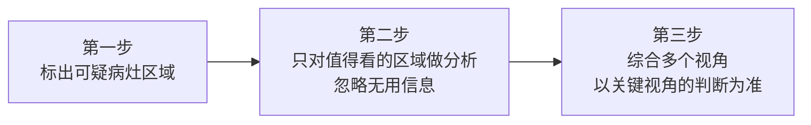
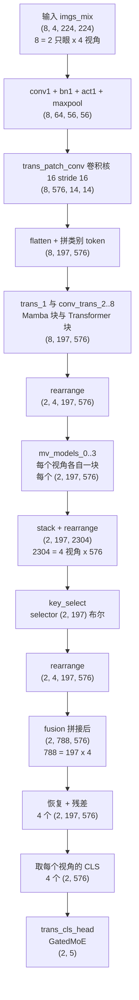
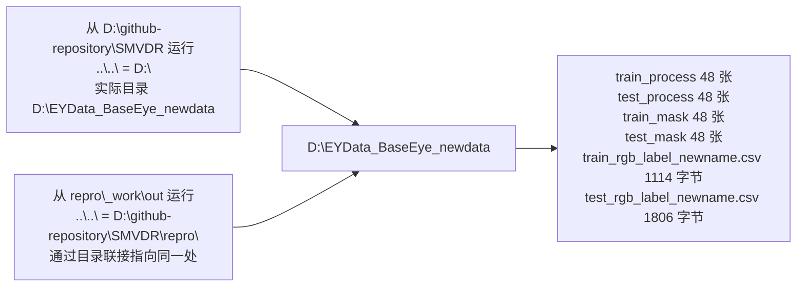
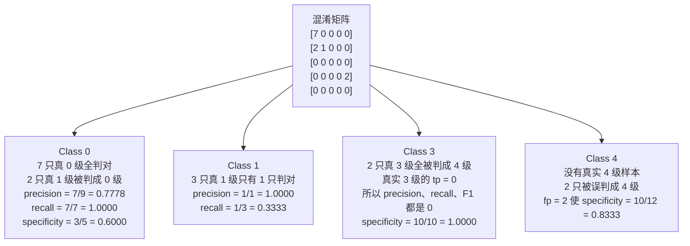
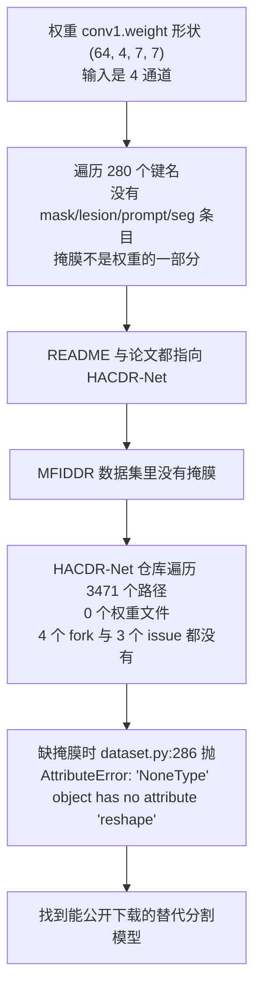

# SMVDR 项目通读：从论文到本机运行结果

面向读者：具备基本 Python 与深度学习常识、没有读过这篇论文、没有接触过眼底图像的本科生。
本文所有数值都标注来源：来自论文 PDF、来自仓库源码、来自你贴出的运行输出，或来自本次在仓库里新做的对照实验。

仓库根目录：`D:\github-repository\SMVDR`
论文：*Like an Ophthalmologist: Dynamic Selection Driven Multi-View Learning for Diabetic Retinopathy Grading*（AAAI 2025，Luo Xiaoling、Xu Qihao、Wu Huisi、Liu Chengliang、Lai Zhihui、Shen Linlin）
论文正文文本已由仓库内 `repro\_work\extract_paper_text.py` 提取到 `repro\_work\paper_text.txt`（945 行）。

---

# 第一部分 这个项目在解决的问题

## 1.1 疾病与分级标准

糖尿病视网膜病变（Diabetic Retinopathy，简称 DR）是糖尿病最常见的并发症，也是成年人失明的主要原因之一。按国际临床分级标准（论文第 49-59 行引用的 Wilkinson 等 2003），医生根据视网膜上出现了哪几类病灶、出现了多少，把病情分成 5 个等级：

| 等级 | 名称 | 典型的视网膜表现 |
| --- | --- | --- |
| 0 | 正常（normal） | 没有病灶 |
| 1 | 轻度（mild） | 只有微血管瘤 |
| 2 | 中度（moderate） | 微血管瘤 + 出血点 + 硬性渗出，程度介于 1 与 3 之间 |
| 3 | 重度（severe） | 出现软性渗出（棉绒斑）、静脉串珠样改变等 |
| 4 | 增殖期（Proliferative Diabetic Retinopathy，PDR） | 新生血管、玻璃体积血 |

这个项目要做的任务就是**输入眼底照片，输出 0 到 4 中的一个等级**，属于图像分类问题。

四类病灶在论文与代码里的缩写：

| 缩写 | 全称 | 中文 | 外观 |
| --- | --- | --- | --- |
| EX | hard Exudates | 硬性渗出 | 边界清楚的黄白色斑点 |
| SE | Soft Exudates | 软性渗出 | 边界模糊的灰白色棉絮状斑，又叫棉绒斑（Cotton Wool spot，缩写 CTW） |
| MA | Microaneurysms | 微血管瘤 | 针尖大小的红色小点，是最早出现的病灶 |
| HE | Hemorrhages | 出血 | 大小不等的红色斑块 |

## 1.2 这个项目的切入点：四个视角而不是一张照片

眼底相机一次拍摄的视野（Field Of View，缩写 FOV）只有 45 度到 50 度，而人眼视网膜能够观察的范围接近 230 度。只用一张黄斑中心照片，周边视网膜上的病灶看不到。

MFIDDR 数据集对每只眼睛拍了四张照片，论文第 580-584 行说明了四个视角的取景：

| 视角 | 取景中心 | 对应文件名的视角号 |
| --- | --- | --- |
| V1 | 黄斑（macula） | `_01`、`_02`（右眼）、`_05`、`_06`（左眼） |
| V2 | 视盘（optic disc） | `_03`、`_07` |
| V3 | 与视盘上水平线相切 | `_04`、`_08` |
| V4 | 与视盘下水平线相切 | 同上 |

四个视角合起来覆盖的范围远大于单独一张。论文的对比实验（Table 1）显示，同一批单视角模型（Inception ResNet V2、MobileNet V2、ResNet50、ResNext50 32x4d、ConvNeXt-B、Swin-B、Vim、RETFound）里最好的单视角结果是 77.03%，而 SMVDR-W 达到 83.03%、SMVDR-M 达到 84.01%。

## 1.3 论文的核心主张：像眼科医生一样"选择"

论文的出发点是一句观察（第 82-91 行）：以往通过增强病灶特征来提升性能的做法，只让模型"更注意"病灶，没有让模型"排除"与诊断无关的区域，模型仍然会被无用信息干扰。

眼科医生读片时的实际流程（论文 Figure 1 的说明）分三步：



SMVDR 把这三步分别实现为三个模块，论文称这条线索为"从细粒度到粗粒度的动态选择"（from fine granularity to coarse granularity）：

| 医生的动作 | 对应模块 | 选择发生在什么层级 |
| --- | --- | --- |
| 标出可疑病灶 | OIR agent（论文用 HACDR-Net 实现） | 像素级：给每个像素标出病灶类别，作为第 4 个输入通道 |
| 只看值得看的地方 | MVTSM（Multi-View Token Selection Module） | 特征块级：对每个空间位置决定保留还是丢弃 |
| 以关键视角为准 | MVMoEM（Multi-View Mixture of Experts Module） | 视角级：给四个视角分配不同的专家组合权重 |

除这三个模块之外，主干网络用的是 Mamba 与 Transformer 的组合（论文称 Mamba-Transformer backbone），视角之间还有一层交互（MVIMamba）。

## 1.4 论文指标与本机结果的对齐点

仓库根目录下有两份文件是作者跑完整数据留下的结果：

`final_test_result.txt`（709 字节）：

```
Test loss: 0.5628, acc: 0.8401, kappa: 0.7136, all_precision: 0.8445,all_recall: 0.8401, all_specificity: 0.9130, all_f1: 0.8369
```

`acc = 0.8401` 与论文 Table 1 里 SMVDR-M 的 `84.01` 完全一致，`kappa = 0.7136` 与论文的 `71.36` 一致，`all_specificity = 0.9130` 与 `91.30` 一致，`all_f1 = 0.8369` 与 `83.69` 一致。

这个对应关系回答了一个关键问题：**仓库里 `weights\best_smvdr.pth` 这份权重就是论文 SMVDR-M 那一行的权重**（`M` 表示使用 mask prompts，见 2.2 节）。

---

# 第二部分 论文方法

## 2.1 Mamba 与 Transformer 的分工

理解主干网络之前需要知道两种序列建模方式的差别。

**Transformer 的自注意力（self-attention）**：每个位置与所有其他位置计算相似度，两两交互。优点是任意两个位置之间的距离不影响建模能力；缺点是计算量与位置数量的平方成正比（197 个 token 要算 197×197 的矩阵）。

**Mamba / 状态空间模型（State Space Model，缩写 SSM）**：把序列看成一个动态系统，用一个隐藏状态随位置递推：

```
h_t = A_bar * h_{t-1} + B_bar * x_t
y_t = C * h_t
```

（论文式 (1)，`repro\_work\paper_text.txt` 第 334-335 行）

递推本身是串行的，但可以用并行扫描（parallel scan）算法在 `2*log2(T)` 步内算完，所以训练时并不慢。Mamba 的关键设计是 `A_bar`、`B_bar`、`C` 都由当前输入 `x_t` 算出来（输入相关，input-dependent），所以模型能够根据内容决定"记住什么、忘掉什么"——这正是论文所说的"输入相关的选择机制"（第 774-776 行）。

论文的消融实验（Table 5）显示只用一个不够：只用 Mamba 是 83.17%/83.22%，只用 Transformer 是 83.17%，两者合起来是 84.01%。Mamba 负责全局的长距离依赖，Transformer 负责局部细节。

## 2.2 OIR agent 与两种提示

论文第 302-306 行：

> OIR agent 可以由任意提示生成模型组成。这里用 HACDR-Net（Xu et al. 2024）作为提示生成器生成 mask prompts（MPs），并从掩膜中随机挑选一部分区域组成 weak prompts（WPs）。

由此产生两个模型变体：

| 变体名 | 使用的提示 | 论文精度 |
| --- | --- | --- |
| SMVDR-M | mask prompts，完整的像素级病灶掩膜 | 84.01% |
| SMVDR-W | weak prompts，从掩膜里随机取一部分区域 | 83.03% |

W 的用途是应对"拿不到完整掩膜"的场景（论文第 309-311 行）。本机复现走的是 M 这条路线。

HACDR-Net 的输出是四类病灶的分割结果。掩膜在代码里作为**第 4 个输入通道**送进网络：`in_chans=4`（`models\create_models.py:9` 与 `test.py:184`），权重里 `conv1.weight` 的形状是 `(64, 4, 7, 7)`——64 个输出通道、4 个输入通道（R、G、B、掩膜）、7×7 卷积核。这一点已经实测核对（`repro\_work\probe\diag_weights.py`）。

## 2.3 GAWMamba 块

GAWMamba 是主干里每个 Mamba 层使用的结构，核心是 GWSSM（Global-Window State-Space Model），它用**三种扫描方向**并行处理同一批 token：

| 扫描方式 | 做什么 | 解决的问题 |
| --- | --- | --- |
| HSScan（水平扫描） | 按行展开成序列后扫描 | 全局水平方向的长距离依赖 |
| VSScan（垂直扫描） | 把图像转置后按行展开再扫描 | 全局垂直方向的长距离依赖 |
| WSScan（窗口扫描） | 把 14×14 切成 4 个 7×7 窗口，各自独立展开后扫描 | 局部区域内的细节 |

论文式 (5)-(8)：

```
z = SiLU(Linear(x))
x_hat = SiLU(Conv1d(Linear(x)))
y_hat = LN(HSScan(x_hat) + VSScan(x_hat) + WSScan(x_hat))
y_tilde = y_hat * z          （* 表示逐元素乘法）
```

代码对应位置在 `models\mamba.py` 的 `MambaBlock.forward`（第 115-183 行）：

```python
x_, class_token = x[:, 0:L - 1, :], x[:, L - 1, :]      # 拆出类别 token
x_ = x.transpose(1, 2).reshape(-1, ED, h, w)            # 还原成 14×14 特征图
x1, x2, x3, x4 = x_[:, :ED, :self.window, :self.window], ...   # 切成 4 个 7×7 窗口
x_1 = x_.flatten(2).transpose(1, 2)                     # 水平扫描
x_2 = x_.transpose(2, 3).flatten(2).transpose(1, 2)     # 垂直扫描（转置）
two_x = [x_1, x_2]
```

`self.window = 7`，所以 `14 = 7 + 7`，四个窗口正好铺满。三条支路各自过 `self.ssm(...)`，结果相加后与 `z` 支路相乘（`output += y * z`），再过 `out_proj`。

`self.ssm` 里的选择扫描由 `models\pscan.py` 的 `PScan` 实现——一个用 Blelloch 算法写的并行扫描，同时手写了反向传播。

**代码与论文的一处差异**：论文式 (7) 对三条支路之和做了 LayerNorm，代码在 `MambaBlock` 内部没有这一步 LayerNorm，归一化发生在 `Block.forward` 的 `self.norm1` 位置（`models\model.py:257`：`x = x + self.drop_path(self.attn(self.norm1(x)))`）。两者作用相近，位置不同。

## 2.4 MVTSM：特征块级选择

论文式 (9)-(12)（第 412-426 行）：

```
Fs = Concat([Fv1, Fv2, ..., FvN])            # 把 N 个视角的特征拼起来
Dc = Softmax(MLP(Fs))                        # 每个 token 产生一个置信度
Si 属于 {0, 1}^M                             # Gumbel-softmax 得到二值选择掩码
Fs_tilde = MLP(Fs) * S                       # 用选择掩码筛选特征
```

训练时用 Gumbel-softmax 让离散决策可以求导，推理时直接取 `argmax`（第 404-408 行）。

代码实现在 `models\mamba.py` 的 `SelectiveModule`（第 533-565 行）：

```python
self.mlp = Mlp(channels, hidden_channels, 2, act_layer=nn.GELU, drop=drop)
self.gate2 = nn.LogSoftmax(dim=-1)
...
x = self.norm(x)
x = self.mlp(x)                    # 输出通道数是 2
scale = self.gate2(x)
if not self.inference:
    selector = F.gumbel_softmax(scale, tau=self.tau, hard=True)[:, :, 0:1]
else:
    selector = torch.argmin(scale, dim=-1, keepdim=True)
```

这里 `inference=True` 是 `models\model.py:382-383` 构造时写定的：

```python
self.key_select = SelectiveModule(channels=embed_dim * num_views, hidden_channels=embed_dim * num_views,
                                  inference=True)
```

所以**推理时走的是 `torch.argmin`，不是 Gumbel-softmax**，训练时也走同一条分支（因为构造时就把 `inference` 固定成 `True`）。

选择结果的用法在 `models\model.py:452-453`：

```python
selector, diff_se = self.key_select(mv_x_t)
mv_x_y = mv_x_t * selector.unsqueeze(-1) + mv_x_t
```

`selector` 是布尔张量，`mv_x_t * selector` 把被选中的部分留下、未选中的位置清零，再加上原始 `mv_x_t`——结果是**未选中的 token 保持原值，选中的 token 数值翻倍**。这实现了"强化关键信息"，实现方式与论文式 (12) 的乘法门控不同。

选择比例的正则项在 `models\mamba.py:568-573`：

```python
def _ratio_loss(ratio_per_sample, selector, ratio=1.):
    if ratio_per_sample is True:
        n_tokens = selector.shape[1]
        return ((selector.sum(dim=1) / n_tokens - ratio) ** 2).mean()
```

训练脚本用 `_ratio_loss(True, selector, ratio=0.7)`（`train.py:95-96`），目标是让 70% 的 token 被选中。论文 Figure 4(b) 的消融实验说明 `t = 0.7` 是效果最好的取值。

本机实测的选择比例（脚本 `repro\_work\probe\probe_selector_rate.py`，12 只测试眼）：

| 眼 | 选中数 | 比例 |
| --- | --- | --- |
| 3411_19640915_right_01 | 188 / 197 | 0.9543 |
| 3411_19640915_left_05 | 190 / 197 | 0.9645 |
| 3413_19670701_right_01 | 196 / 197 | 0.9949 |
| 3413_19670701_left_05 | 187 / 197 | 0.9492 |
| 4499_19530815_right_01 | 197 / 197 | 1.0000 |
| 4499_19530815_left_05 | 2 / 197 | 0.0102 |
| 4501_19790823_right_01 | 197 / 197 | 1.0000 |
| 4501_19790823_left_05 | 196 / 197 | 0.9949 |
| 3404_19820909_right_01 | 196 / 197 | 0.9949 |
| 3404_19820909_left_05 | 195 / 197 | 0.9898 |
| 4500_19700910_right_01 | 81 / 197 | 0.4112 |
| 4500_19700910_left_05 | 4 / 197 | 0.0203 |

选择比例在两个极端之间跳动（0.01 与 1.00），而训练目标 `ratio=0.7` 完全没有约束住它。原因是 `_ratio_loss` 的返回值 `requires_grad` 是 `False`，它作用在 `argmin` 产生的布尔张量上，与计算图断开，所以 `0.1 * L_s` 这一项不产生任何梯度，`ratio` 参数只影响打印出来的损失数值。实测记录（脚本 `repro\_work\probe\probe_loss_terms.py`）：`L_c` 的 `requires_grad` 是 `True`（0.085566），`L_s` 是 `False`（0.059615），`L_f` 是 `True`（0.982766）；反向传播后 `conv1`、`fusion.in_proj`、`trans_cls_head.Wg`、`trans_cls_head.final_fc` 的梯度都存在，而 `key_select.norm` 的梯度是 `None`。

## 2.5 MVIMamba 与 MVSScan：视角之间的交互

论文第 448-464 行说明 MVSScan 的做法：把各视角的 token **按空间位置对应**，同一位置上的 N 个视角 token 按视角顺序拼成一段，然后用双向扫描（1→N 与 N→1）做交互建模。

代码在 `models\mamba.py` 的 `MambaFusion.forward`（第 449-483 行）：

```python
x = torch.cat([tensor[:, i::4, :] for i in range(4) for tensor in tensors], dim=1)
```

外层循环是位置步长 `i`（0..3），内层循环是视角 `tensor`（0..3）。拼接顺序是：视角 0 的第 0、4、8…个 token，然后视角 1 的第 0、4、8…个 token，依次到视角 3；接着换到位置 1、5、9…重复。这样 Mamba 在序列上向前扫描时，相邻的 token 来自不同视角的相近空间位置，实现了跨视角的信息交流。

扫描结果恢复时按同样的索引取回，并把原始输入加回去（第 477-481 行）。

本次实测的形状：输入 4 个 `(2, 197, 576)`，拼接后是 `(2, 788, 576)`，扫描后恢复成 4 个 `(2, 197, 576)`。788 = 197 × 4。

## 2.6 MVMoEM：视角级动态融合

论文式 (14)（第 481-504 行）：给每个视角配一个独立的路由器 `Ri`，路由器用 Top-2 稀疏门控从共享专家池里挑出 2 个专家，加权求和得到该视角的表示，再把各视角的表示合成最终特征。

代码在 `models\moe.py` 的 `GatedMoE`（第 20-60 行）：

```python
H = x @ self.Wg + self.b
expert_probabilities.append(F.softmax(H, dim=-1))
top_k_values, _ = torch.topk(H, self.top_k, dim=-1)
mask = H >= top_k_values[:, -1, None]
H_top_k = H.masked_fill(~mask, float('-inf'))
G = F.softmax(H_top_k, dim=1)
expert_outputs.append(torch.stack([expert(x) for expert in self.experts], dim=1))
...
combined_output = sum(torch.sum(G.unsqueeze(-1) * e, dim=1)
                      for G, e in zip(gates, expert_outputs)) / len(x_list)
```

构造参数是 `GatedMoE(embed_dim, 256, num_classes, num_experts=4, top_k=2, tau=1)`（`models\model.py:301`），即 4 个专家、每个视角取 Top-2。每个专家是一个两层全连接（`FFN`，576 → 256 → 256），最后过 `final_fc` 得到 5 类输出。

论文式 (14) 写的是把各视角的加权输出求和；代码做的是**先算每个视角各自的加权专家输出，再对视角取平均**（`/ len(x_list)`，`len(x_list) = 4`）。

## 2.7 损失函数

论文式 (17)：`L_total = L_c + alpha * L_s + beta * L_f`

| 符号 | 名称 | 实现位置 | 作用 |
| --- | --- | --- | --- |
| `L_c` | 分类损失，用 focal loss | `models\FLoss.py` | 处理类别不均衡，让模型关注难分类样本 |
| `L_s` | 选择比例损失 | `models\mamba.py:568` 的 `_ratio_loss` | 控制 token 选择比例接近目标值 t |
| `L_f` | 专家熵正则 | `models\moe.py:67` 的 `entropy_regularization_loss` | 让各视角的专家分布既不过于集中也不过于分散 |

focal loss 的公式与代码（`models\FLoss.py:12-26`）：

```python
ce_loss = F.cross_entropy(logits, labels, reduction="none")
log_pt = -ce_loss
pt = torch.exp(log_pt)
weights = (1 - pt) ** gamma
fl = weights * ce_loss
```

`(1 - pt)^gamma` 让已经分对的样本权重下降（`pt` 接近 1 时权重接近 0），难分样本权重保持。训练用 `gamma=2`。

`L_f` 的公式与代码（论文式 (15)，`models\moe.py:67-75`）：

```
E = | (1/M) * 求和_i H(P_i)  -  H( (1/M) * 求和_i P_i ) |
```

即"各视角专家分布熵的平均"与"平均专家分布的熵"之差的绝对值。差值大说明各视角用的专家不集中，正则项推着模型让各视角的专家使用更协调。

训练脚本里三个权重是 `+ 0.1 * L_s + 0.1 * L_f`（`train.py:95-97`），对应论文的 alpha = beta = 0.1。

---

# 第三部分 代码逐段对照

## 3.1 文件清单

| 文件 | 字节数 | 职责 |
| --- | --- | --- |
| `process_image.py` | 1642 | 眼底图预处理：裁黑边、缩放到 1280×1280、做增强 |
| `dataset.py` | 15676 | 四个 Dataset 类；本任务用 `MultiviewImgDataset_mask` |
| `train.py` | 10344 | 训练脚本，含 `main()` 与 `val_model()` |
| `test.py` | 8378 | 测试脚本，含 `test_model2()` 与 `__main__` 推理流程 |
| `models\create_models.py` | 1891 | 模型工厂 `my_SMVDR()`，负责构造与加载权重 |
| `models\model.py` | 21629 | 主模型 `SMVDR`、`Block`、`SSA`、`jointLayer` |
| `models\mamba.py` | 23304 | `MambaBlock`、`MambaFusion`、`SelectiveModule`、`_ratio_loss` |
| `models\moe.py` | 2726 | `GatedMoE`、`FFN`、`entropy_regularization_loss` |
| `models\FLoss.py` | 1175 | `FocalLoss` |
| `models\pscan.py` | 3859 | 并行扫描 `PScan` |
| `models\non_local_simple_version.py` | 5158 | `NONLocalBlock2D`，被 `jointLayer` 使用 |
| `models\feature_visualization.py` | 2595 | 特征图可视化工具，只被 import 不使用 |

## 3.2 process_image.py

`preprocess_image(image, sigmaX=15)` 做四件事（第 41-52 行）：

```python
image = cv2.imread(image)
image = cv2.cvtColor(image, cv2.COLOR_BGR2RGB)
image = crop_image_from_gray(image)                        # 裁掉黑边
image = cv2.resize(image, (IMG_WIDTH, IMG_HEIGHT))         # 缩放到 1280×1280
img_ori = cv2.cvtColor(image, cv2.COLOR_RGB2BGR)
image = cv2.addWeighted(image, 4, cv2.GaussianBlur(image, (0, 0), sigmaX), -4, 128)
return image, img_ori
```

最后一行是经典的眼底图增强手法（业界常称 Ben Graham 预处理）：原图放大 4 倍，减去 4 倍的模糊图，再加 128。作用是**减去低频亮度分量、保留局部对比度，并把整体亮度抬到中灰**，让不同曝光条件下拍出的眼底图看起来一致。

`crop_image_from_gray(img, tol=7)` 的判定（第 27-38 行）：把图转成灰度，取 `gray > 7` 作为前景掩码，按行和列压缩得到前景的外接矩形，用 `np.ix_` 取出该矩形区域的三个通道。这个函数**只返回裁剪后的图，不返回裁剪索引**——这个特性在生成掩膜时造成了一个必须单独处理的麻烦，见第七部分。

原始样例图尺寸是 `(2056, 2124, 3)`（高、宽、通道），预处理后统一到 `(1280, 1280, 3)`。

## 3.3 dataset.py

文件里定义了 6 个类，实际用到的是 `MultiviewImgDataset_mask`：

| 类 | 行 | 说明 |
| --- | --- | --- |
| `CustomDataset` | 18-42 | 单图 + 标签，本任务不使用 |
| `SingleimgDataset` | 45-101 | 单图 + 标签，本任务不使用 |
| `MultiviewImgDataset_no_lesion` | 104-169 | 4 视角、3 通道，与 `in_chans=4` 不匹配 |
| `MultiviewImgDataset` | 172-237 | 4 视角、3 通道 |
| `MultiviewImgDataset_mask` | 240-298 | **4 视角、4 通道（含掩膜）**，训练与测试都使用 |
| `MultiviewImgDataset_noAggregate` | 301-368 | 4 视角，输入是掩膜本身，本任务不使用 |

`MultiviewImgDataset_mask` 的关键代码（第 254-298 行）：

```python
def __len__(self):
    return len(self.data_list) // 4              # 4 行 CSV = 1 只眼

def __getitem__(self, idx):
    class_id = self.data_list.iloc[idx * 4, 1].astype(np.int64)    # 取该组 4 行的标签
    imgs = []
    for view in range(self.num_views):
        img_name = '{}.jpg'.format(self.data_list.iloc[idx * 4 + view, 0])
        mask_name = '{}.png'.format(self.data_list.iloc[idx * 4 + view, 0] + '_mask')
        ...
        image = cv2.cvtColor(cv2.imread(img_path), cv2.COLOR_BGR2RGB)
        mask = cv2.imread(mask_path, 0)                          # 第 284 行：掩膜缺失时这里返回 None
        mask = mask.reshape((1280, 1280, 1))                      # 第 286 行：None 在这里抛错
        if self.no_mask:
            mask[:]=255
        hun = np.append(image, mask, axis=2)                      # 拼成 4 通道
        if self.transform:
            image = self.transform(hun)
        imgs.append(image)
    return torch.stack(imgs), class_id
```

三个要点：

1. **CSV 每 4 行对应一只眼**。`data_list.iloc[idx * 4 + view, 0]` 取文件名，`data_list.iloc[idx * 4, 1]` 取标签。CSV 必须按"同一只眼的四个视角连续排列"组织，否则标签会错配。
2. **掩膜是灰度 PNG，尺寸必须是 1280×1280**。第 286 行写死了 `reshape((1280, 1280, 1))`，尺寸不符会抛 `ValueError`。
3. **`no_mask=True` 时掩膜被整幅涂成 255**。这对应论文 Table 5 的 `w/o prompts` 消融，论文的精度是 81.64%。

第 289 行 `np.append(image, mask, axis=2)` 把 `(1280, 1280, 3)` 的 RGB 图和 `(1280, 1280, 1)` 的掩膜拼成 `(1280, 1280, 4)` 的 uint8 数组，交给 `transform`。

## 3.4 第 4 通道的变换链（本次实测的核心发现）

`train.py:221-232` 与 `test.py:169-174` 里的变换链是：

```python
transform.Compose([
    transform.ToPILImage(),
    transform.Resize((224, 224)),
    transform.ToTensor(),
])
```

第 289 行拼出来的数组形状是 `(1280, 1280, 4)`。`ToPILImage` 收到 4 通道数组时会按 **RGBA** 解释它（modes 推断规则：3 通道 → RGB，4 通道 → RGBA），于是**掩膜的值变成了 alpha 通道**。

这一步本身在数值上没有问题，实测确认：

| 检查项 | 结果 |
| --- | --- |
| `ToPILImage` 后的 mode | `RGBA` |
| `np.array(pil)[:, :, :3]` 与原始 RGB 是否逐像素相同 | True |
| `np.array(pil)[:, :, 3]` 与掩膜是否逐像素相同 | True |

问题出在下一步 `Resize`。Pillow 的 `Image.resize` 对 `RGBA` 模式（非 `NEAREST` 滤波）会走这一段（`PIL/Image.py` 的 `resize` 方法原文）：

```python
if self.mode in ["LA", "RGBA"] and resample != Resampling.NEAREST:
    im = self.convert({"LA": "La", "RGBA": "RGBa"}[self.mode])
    im = im.resize(size, resample, box)
    return im.convert(self.mode)
```

`RGBa` 是**预乘 alpha（premultiplied alpha）**模式：RGB 的存储值等于真实颜色乘以 alpha。这一步会先做预乘，缩放之后再转回 `RGBA`（反预乘）。用 8 位整数做预乘与反预乘会带来严重的量化误差，用可控数组实测（RGB 恒为 200，只扫 alpha）：

| alpha | 变换后 RGB | 说明 |
| --- | --- | --- |
| 0 | 0 | 预乘后为 0，反预乘无法恢复 |
| 1 | 255 | 预乘后为 1，反预乘 1 ÷ 1 × 255 = 255，饱和 |
| 2 | 255 | 同上，饱和 |
| 3 | 170 | 预乘后为 2，反预乘 2 ÷ 3 × 255 = 170 |
| 5 | 204 | |
| 51 | 200 | 与原始值一致 |
| 128 | 199 | |
| 255 | 200 | 与原始值一致 |

结论：**alpha 为 0 的像素，RGB 一定变成 0；alpha 很小时，RGB 被放大并饱和到 255。**

真实掩膜里 alpha 为 0 的像素占 99.9%（本机统计：96 张掩膜共 157,286,400 个像素，背景占 157,123,881 个，即 99.8967%）。所以官方管线下喂进网络的张量里，**RGB 三通道在 99.9% 的位置上都变成了 0**。

本机实测（脚本 `repro\_work\probe\probe_what_model_sees.py`，12 只测试眼）：

| 眼 | 等级 | 掩膜非零像素 | RGB 非零比例 | RGB 均值 |
| --- | --- | --- | --- | --- |
| 3411_19640915_right_01 | 0 | 114 | 0.0000 | 0.000033 |
| 3411_19640915_left_05 | 1 | 289 | 0.0001 | 0.000110 |
| 3413_19670701_right_01 | 0 | 847 | 0.0006 | 0.000387 |
| 3413_19670701_left_05 | 0 | 0 | 0.0000 | 0.000000 |
| 4499_19530815_right_01 | 0 | 19 | 0.0000 | 0.000000 |
| 4499_19530815_left_05 | 0 | 0 | 0.0000 | 0.000000 |
| 4501_19790823_right_01 | 0 | 0 | 0.0000 | 0.000000 |
| 4501_19790823_left_05 | 0 | 370 | 0.0002 | 0.000153 |
| 3404_19820909_right_01 | 1 | 369 | 0.0002 | 0.000169 |
| 3404_19820909_left_05 | 1 | 435 | 0.0002 | 0.000176 |
| 4500_19700910_right_01 | 3 | 10352 | 0.0069 | 0.004405 |
| 4500_19700910_left_05 | 3 | 14157 | 0.0090 | 0.005835 |

RGB 通道的非零像素比例在 0.0000 到 0.0090 之间。

一个决定性的验证（脚本 `repro\_work\probe\probe_decisive_proof.py`）：把掩膜整幅置零后，12 只眼在官方变换后的输入张量**完全相同**（差异个数 0 / 11），因为 alpha 全为 0 时 RGB 全被清零，而第 4 通道也都是 0。此时网络看到的是同一张全零图。

| 掩膜模式 | 与第 0 只眼输入不同的样本数 | RGB 通道均值 |
| --- | --- | --- |
| 真实掩膜 | 11 / 11 | 0.000063 |
| 掩膜整幅置零 | **0 / 11** | 0.000000 |
| 掩膜整幅置 255 | 11 / 11 | 0.502320 |

## 3.5 这份权重与官方管线的匹配关系（本次实测）

把 RGB 与掩膜**分别变换再拼接**（下称"正确管线"）之后，同一份权重在同样 12 只测试眼上的表现急剧恶化：

| 管线 | train 子集 acc | test 子集 acc | train 损失 | test 损失 |
| --- | --- | --- | --- | --- |
| 官方管线（RGB 被 alpha 压制） | 0.8333 | 0.6667 | 0.5184 | 0.7132 |
| 正确管线（RGB 完整保留） | 0.0000 | 0.0000 | 3.5061 | 5.2332 |

（脚本 `repro\_work\probe\probe_decisive.py`。train 子集来自 MFIDDR 官方 train-examples，按论文的 25,848 张训练集划分，这 12 只眼很可能出现在作者的训练数据里。）

另一条独立的证据来自权重自带的 BatchNorm 统计量。`bn1.running_mean` 与 `bn1.running_var` 是作者训练时 `conv1` 输出的逐通道均值与方差（`num_batches_tracked = 455712`，即统计了 45 万个批次），它们是训练数据的直接记录。用它们作为判据比较各条管线：

| 管线 | conv1 输出标准差 ÷ 目标标准差（中位数） | 逐通道均值与 running_mean 的相关 | 均值偏差 |
| --- | --- | --- | --- |
| 官方管线 | 0.3842 | 0.9802 | 0.001486 |
| 正确管线 | 2.0103 | 0.9752 | 0.177690 |
| 正确管线 + ImageNet 标准化 | 7.0275 | 0.7530 | 0.125818 |

（脚本 `repro\_work\probe\probe_pipeline_identity.py`，96 张图一起统计。）

官方管线的 conv1 输出与作者训练时的记录最接近（均值逐通道相关 0.98，均值偏差 0.0015），正确管线的均值偏差是它的 120 倍。

两条证据指向同一个判断：**这份权重是在 RGB 被 alpha 压制的条件下训练出来的**，作者跑 `train.py` 时喂进网络的输入与 `test.py` 现在产生的一致。训练与推理用的是同一条管线，所以结果自洽，作者报告 84.01% 也没有矛盾——只是网络实际看到的内容与论文文字描述的"多视角眼底图像 + 病灶提示"有差别：RGB 的几何信息几乎全部丢失，第 4 通道（掩膜）成了主要信息来源。

用逐通道替换实验可以进一步看到两个通道各自的贡献（脚本 `repro\_work\probe\probe_ablation_channel.py`，同一只眼的四个视角用同一张图，只看单视角响应）：

| 检验 | 操作 | 输出最大变化量 |
| --- | --- | --- |
| A | 掩膜不变，RGB 换成另一只眼的 RGB | 0.0000 到 2.6513，11 只里 5 只的变化小于 0.001 |
| B | 掩膜不变，RGB 整幅换成 0 | 0.0000 到 9.2677 |
| C | RGB 不变，掩膜换成另一只眼的掩膜 | 0.0000 到 8.1698 |
| D | RGB 不变，掩膜整幅置零 | 0.0000 到 7.3017 |

检验 A 里有 5 只眼的输出完全不变，进一步印证 RGB 的贡献很小。

## 3.6 models\create_models.py

`my_SMVDR()` 是模型工厂（第 6-38 行）：

```python
def my_SMVDR(pretrained=False, depth=12, num_heads=9, cuda='cuda:0', **kwargs):
    pre_Path = kwargs['pre_Path']                # 第 7 行：无条件取，必须传
    kwargs.pop('pre_Path', None)
    model = SMVDR(patch_size=16, channel_ratio=6, embed_dim=576, depth=depth,
                  num_heads=num_heads, mlp_ratio=4, qkv_bias=True, **kwargs)
    if pretrained:
        checkpoint = torch.load(pre_Path, map_location=cuda)
        state_dict = model.state_dict()
        if isinstance(checkpoint, dict):
            if 'model' in checkpoint.keys():
                checkpoint_model = checkpoint['model']
            else:
                checkpoint_model = checkpoint
            load_dict = {k: v for k, v in checkpoint_model.items() if k in state_dict.keys()}
            ...
            state_dict.update(load_dict)
            try:
                model.load_state_dict(state_dict)
            except Exception as e:
                print(str(e))
            print("model load state dick!")      # 第 34 行，作者把 dict 拼成了 dick
        else:
            model = checkpoint
    return model
```

加载权重这一步有**两个会静默出问题的地方**：

1. 第 22 行的字典推导只保留键名能对上的条目。如果整套键名都对不上（例如换了模型结构），`load_dict` 就是空字典，模型保持随机初始化。
2. 第 30-33 行把 `load_state_dict` 包在 `try/except` 里，出错只打印一行异常字符串，程序继续往下跑。

两处叠加的结果是：**权重加载失败时程序照常运行、测试照常输出准确率数字，只是数字没有意义**。本机复现时为这一点专门加了键名覆盖检查（`repro\scripts\check_setup.py` 与 `repro\scripts\smoke_test.py`），实测 280/280 全部命中、形状全部一致。

`pretrained=False` 时 `pre_Path` 仍然必须传入，因为第 7 行是无条件取值。

## 3.7 models\model.py 的 SMVDR.forward

这是理解整个模型的枢纽，逐步走一遍（第 423-461 行）：

```python
def forward(self, x):
    B = x.shape[0]                       # B = 批量 * 4 个视角
    b = B // self.num_view               # b = 实际的眼睛数量
    cls_tokens = self.cls_token.expand(B, -1, -1)

    x_base = self.maxpool(self.act1(self.bn1(self.conv1(x))))    # 第 1 步
    x_t = self.trans_patch_conv(x_base)                          # 第 2 步
    x_t = x_t.flatten(2).transpose(1, 2)
    x_t = torch.cat([cls_tokens, x_t], dim=1)                    # 第 3 步
    x_t = self.trans_1(x_t)                                      # 第 4 步

    for i in range(2, self.fin_stage):                           # 第 5 步：i = 2..8
        x_t = eval('self.conv_trans_' + str(i))(x_t)

    x_t = rearrange(x_t, '(b v) c e -> b v c e', v=4)            # 第 6 步

    mv_x_t = []
    for i in range(0, self.num_view):                            # 第 7 步：四个视角各自过一块
        sv_x_t = eval('self.mv_models_' + str(i))(x_t[:, i])
        mv_x_t.append(sv_x_t)

    mv_x_t = rearrange(torch.stack(mv_x_t, 1), 'b v c e -> b c (v e)')   # 第 8 步

    selector, diff_se = self.key_select(mv_x_t)                  # 第 9 步：MVTSM
    mv_x_y = mv_x_t * selector.unsqueeze(-1) + mv_x_t

    mv_x_y = rearrange(mv_x_y, 'b c (v e) -> b v c e', v=4)
    mv_x_1 = self.fusion([mv_x_y[:, i, :, :] for i in range(self.num_view)])   # 第 10 步：MVIMamba
    x_t = torch.stack(mv_x_1, 1)

    output, expert_probabilities = self.trans_cls_head([x_t[:, i, 0] for i in range(self.num_view)])  # 第 11 步：MVMoEM

    return output, expert_probabilities, selector
```

第 8 步之后 `mv_x_t` 的形状是 `(b, 197, 2304)`——197 是 token 数（1 个类别 token + 14×14 = 196 个图像 token），2304 是 4 个视角 × 576 维。这个形状由 hook 实测确认（脚本 `repro\_work\probe\diag_shapes.py`）。

MVTSM 的选择作用在第 2 维（token 位置维）上，即**对每个空间位置决定是否强化，作用于四个视角拼接后的整条 2304 维向量**。这与"跨视角同一空间位置的病灶相关性"这个设计意图吻合。

`selector` 张量的形状是 `(b, 197)`，布尔类型，第 0 个位置（类别 token）在 `SelectiveModule.forward` 里被强制置为 1（`models\mamba.py:561`）：

```python
selector = torch.cat((torch.ones(B, 1, 1, device=selector.device), selector), dim=1).bool().squeeze(2)
```

`SMVDR.__init__` 里有两个模块被构造但从不调用：

| 模块 | 行 | 元素个数 | 状态 |
| --- | --- | --- | --- |
| `jointLayer` | 379 | 51,919,105 | 构造了，`forward()` 里没有出现 |
| `trans_cls_head_dan` | 303-309 | 1,182,725 | 构造了，`forward()` 里没有出现 |

两者合计 53,101,830 个参数，占全部 108,990,864 个可训练参数的 **48.7%**。`jointLayer.conv1.weight` 一个张量就是 3072×1536×3×3 = 42,467,328 个参数，是显存占用的大头之一。论文里的对应结构应当是 MVIMamba 的一种备选实现，作者在最终版本里换成了 `MambaFusion`（即 `self.fusion`），旧模块留在代码里没有清理。

## 3.8 test.py

`test_model2(netname, model, test_loader, dataset_size, criterion, device)` 是核心的评估函数（第 21-164 行）。它做四件事：

**第一件：推理并收集输出**（第 46-67 行）

```python
for i, (img, label) in enumerate(valid_bar):
    img = img.to(device)
    B, V, C, H, W = img.size()          # (批量, 4, 4, 224, 224)
    img = img.view(-1, C, H, W)         # 展平成 (批量*4, 4, 224, 224)
    with torch.no_grad():
        evidences, expert_probabilities, selecter = model(img)
    outputs = evidences.cpu()
    loss = criterion(outputs, label)
    ...
```

一个样本（一只眼）的四个视角展平成一个批次维度送进模型，输出 `(批量, 5)`，即每只眼一个 5 类结果。

**第二件：混淆矩阵与逐类指标**（第 68-120 行）

```python
preds = torch.argmax(total_outs, dim=1)
outputs_softmax = torch.softmax(total_outs, 1)
...
FM[true_label][predict_label] = FM[true_label][predict_label] + 1
```

注意第 93 行 `FM[true_label][predict_label]`：**第 1 个下标是真值，第 2 个下标是预测值**。所以打印出来的矩阵第 i 行是"真实等级 i 的样本被分到了哪些类"。你输出里的矩阵读法是：

```
[[7. 0. 0. 0. 0.]     真实 0 级：7 只全对
 [2. 1. 0. 0. 0.]     真实 1 级：3 只里 2 只误判为 0 级、1 只判对
 [0. 0. 0. 0. 0.]     测试集里没有真实 2 级
 [0. 0. 0. 0. 2.]     真实 3 级：2 只全被判成 4 级
 [0. 0. 0. 0. 0.]]    测试集里没有真实 4 级
```

逐类指标的定义（第 110-113 行）：

```python
precision[label]   = tp / (tp + fp + 1e-8)
recall[label]      = tp / (tp + fn + 1e-8)      # 就是论文里的 Sens.
specificity[label] = tn / (tn + fp + 1e-8)
f1[label]          = 2 * precision * recall / (precision + recall + 1e-8)
```

`1e-8` 加在分母上，避免分母为 0 时崩溃。`specificity`（特异度）衡量的是"不是这个等级、模型也说不是"的比例。

**第三件：kappa 系数**（第 134-142 行）

```python
pe0 = (tp[0] + fn[0]) * (tp[0] + fp[0])
...
pe = (pe0 + pe1 + pe2 + pe3 + pe4) / (dataset_size * dataset_size)
pa = (tp[0] + tp[1] + tp[2] + tp[3] + tp[4]) / dataset_size
kappa = (pa - pe) / (1 - pe)
```

kappa 衡量的是"扣掉随机猜测的贡献之后，模型的准确率还有多少"。`pa` 是整体准确率，`pe` 是完全随机按类别分布猜测时的期望准确率。kappa 为 0 表示与随机猜测同水平，为 1 表示完全正确。医学分级任务里 kappa 比准确率更有说服力，因为类别不均衡时全部猜多数类也能拿到不低的准确率。

论文 Table 1 里 SMVDR-M 的 kappa 是 71.36，仓库 `final_test_result.txt` 是 0.7136，完全对应。

**第四件：四个加权平均指标与写文件**（第 144-163 行）

```python
overall_precision = sum([cls_statis[i] * p for i, p in enumerate(precision)]) / sum(cls_statis)
```

`cls_statis[i]` 是第 i 类的样本数，所以这是按类别样本量加权的平均。第 117-132 行把逐类指标、混淆矩阵、总体指标追加写入 `{netname}_test_result.txt`，第 132 行把每个样本的五类 softmax 概率写入 `{netname}_roc_data.csv`（`encoding='gbk'`）。

`__main__` 块（第 167-204 行）里的两点说明：

1. **路径是相对路径，按当前工作目录解析**，与 `test.py` 文件的位置无关。从仓库根目录运行时 `../../` 指到 `D:\`，所以数据目录是 `D:\EYData_BaseEye_newdata`；从 `repro\_work\out` 运行时指到 `D:\github-repository\SMVDR\repro\`，通过目录联接同样指向真实数据目录。
2. **第 181 行 `checkpoint = torch.load(MODELPATH, map_location=device)` 加载出来的对象从未被使用**。模型实际由 `create.my_SMVDR(pretrained=True, ...)` 内部的 `torch.load` 重新加载一次。这一行只是多花了一次读盘时间。

## 3.9 train.py

`main()` 的训练循环（第 79-136 行）：

```python
for epoch in range(N_EPOCHS):
    model.train()
    for i, (img, label) in enumerate(train_bar):
        ...
        imgs_mix = img.view(-1, C, H, W)
        evidences, expert_probabilities, selector = model(imgs_mix)
        loss = criterion(evidences, label) + 0.1 * _ratio_loss(True, selector, ratio=0.7) \
            + 0.1 * entropy_regularization_loss(expert_probabilities)
        optimizer.zero_grad()
        loss.backward()
        optimizer.step()
        train_epoch_acc += (evidences.argmax(dim=1) == label).sum()
        train_epoch_loss += loss.item()
        scheduler.step(epoch + i / len(train_loader))
        optimizer.step()                       # 第 104 行：第二次调用
```

第 98 行与第 104 行之间有两次 `optimizer.step()`。第一次步进是正常的参数更新；第二次步进在同一个梯度上再走一步，相当于把学习率的效果放大了一倍。这个行为在论文里没有描述，属于仓库代码的实际状态。

`val_model()`（第 139-178 行）：

```python
val_acc_mean = valid_epoch_acc / (len(valid_dataset) * NUM_VIEW)
```

`valid_dataset` 与 `NUM_VIEW` 是**模块级的全局名字，但定义在 `if __name__ == '__main__':` 块里**（第 196 行 `NUM_VIEW = 1`，第 237 行 `valid_dataset = ...`）。直接 `python train.py` 运行时这块会执行，所以没有问题；把 `train.py` 当模块 import 时这两个名字不存在，`val_model` 会抛 `NameError`。本机的训练驱动脚本因此需要显式注入这两个名字。

`__main__` 块的其余关键取值：

| 变量 | 行 | 取值 | 含义 |
| --- | --- | --- | --- |
| `NUM_VIEW` | 196 | 1 | 用于验证准确率的归一化，配合 `evidences` 已经是每只眼一个输出 |
| `IMAGE_SIZE` | 197 | 224 | 输入分辨率 |
| `LR` | 198 | 0.00001 | 学习率，与论文一致 |
| `N_EPOCHS` | 199 | 100 | 训练轮数 |
| `DEPTH` | 200 | 12 | Transformer/Mamba 块数 |
| `HEAD` | 201 | 9 | 注意力头数 |
| `BATCH_SIZE` | 202 | 2（原为 4） | 每个批次的眼睛数 |

保存权重（第 135 行）：

```python
torch.save(model.state_dict(), 'best_smvdr.pth')
```

保存的路径是相对路径，按当前工作目录解析，而且保存的是**最后一轮**的权重，不是验证准确率最高的那一轮。第 120 行确实把最佳权重存进了 `best_model` 变量，但没有任何一行把它写盘。这个行为对复现论文结果有影响：论文的 84.01% 对应的应当是验证集最优的那一轮。

训练变换里 `RandomResizedCrop(IMAGE_SIZE)` 的默认 `scale=(0.08, 1.0)`（`train.py:216`）。RGBA 图像的随机裁剪同样会触发预乘 alpha 的路径。

## 3.10 论文与代码的差异汇总

| 项目 | 论文写法 | 代码实际 | 影响 |
| --- | --- | --- | --- |
| 输入图像 | 多视角眼底图 + 像素级提示 | 4 通道数组经 `ToPILImage` 当成 RGBA，`Resize` 预乘 alpha 把背景处 RGB 清零 | RGB 几何信息几乎全部丢失，掩膜成为主要信息来源 |
| 备份掩码的使用 | 式 (12) `Fs_tilde = MLP(Fs) * S` | `mv_x_t * selector + mv_x_t`（选中的数值翻倍） | 实现方式不同，效果相近 |
| `L_s` 的优化 | 式 (13) 参与总损失 | `_ratio_loss` 返回值 `requires_grad=False` | 该项不产生梯度，选择比例不受它约束 |
| GAWMamba 的归一化位置 | 式 (7) 对三条扫描之和做 LN | LN 在 `Block` 的 `norm1` 位置 | 位置不同 |
| MVMoEM 的视角合并 | 式 (14) 对各视角加权输出求和 | 各视角加权输出取平均 | 尺度不同 |
| 最佳权重保存 | 通常保存验证最优轮 | 保存最后一轮 | 复现结果会有偏差 |
| 优化器步进 | 每批次一次 | 每批次两次 | 等效学习率放大 |
| `jointLayer` | 未在论文正文出现 | 构造 51,919,105 个参数但不参与前向 | 显存占用大，计算无用 |
| `trans_cls_head_dan` | 未在论文正文出现 | 构造 1,182,725 个参数但不参与前向 | 同上 |

---

# 第四部分 张量形状走一遍

以下形状由 hook 实测得到（脚本 `repro\_work\probe\diag_shapes.py`，批量 2 只眼、每只 4 个视角）。



分阶段的实测记录：

| 位置 | 输入形状 | 输出形状 |
| --- | --- | --- |
| `conv1` | `(8, 4, 224, 224)` | `(8, 64, 112, 112)` |
| `trans_patch_conv` | `(8, 64, 56, 56)` | `(8, 576, 14, 14)` |
| `trans_1.attn.mamba.in_proj` | `(8, 197, 576)` | `(8, 197, 1152)` |
| `trans_1.attn.mamba.conv1d_0` | `(8, 576, 197)` | `(8, 576, 200)` |
| `trans_1.attn.mamba.x_proj` | `(8, 197, 576)` | `(8, 197, 68)` |
| `trans_1.attn.mamba.dt_proj` | `(8, 197, 36)` | `(8, 197, 576)` |
| `trans_1.attn.mamba.conv1d_2`（窗口支路） | `(8, 576, 49)` | `(8, 576, 49)` |
| `conv_trans_8.trans_block.attn.attn_drop` | `(8, 9, 197, 197)` | 同形状（Transformer 注意力矩阵） |
| `mv_models_0.trans_block.attn.attn_drop` | `(2, 9, 197, 197)` | 同形状（单视角内） |
| `key_select.mlp.fc1` | `(2, 196, 2304)` | `(2, 196, 2304)` |
| `key_select.mlp.fc2` | `(2, 196, 2304)` | `(2, 196, 2)` |
| `fusion.in_proj` | `(2, 788, 576)` | `(2, 788, 2304)` |
| `fusion.out_proj` | `(2, 788, 1152)` | `(2, 788, 576)` |
| `trans_cls_head.experts.0.fc1` | `(2, 576)` | `(2, 256)` |
| `trans_cls_head.final_fc` | `(2, 256)` | `(2, 5)` |

几个数字的来源：

- **197 = 1 + 196**。类别 token 一个，图像 token 是 `14 × 14 = 196`。
- **14 = 224 / 16**。经过 `conv1`（stride 2，除以 2）、`maxpool`（stride 2，再除以 2）、`trans_patch_conv`（卷积核 16、stride 16，再除以 16），224 / 2 / 2 / 16 = 14。
- **576** 是 `embed_dim`（`models\create_models.py:9` 的固定值）。
- **68 = 36 + 16 + 16**。`x_proj` 输出 `dt_rank + 2 * d_state`，其中 `dt_rank = ceil(576/16) = 36`（`models\mamba.py:54`），`d_state = 16`（`models\mamba.py:35`）。
- **1152 = 2 × 576**。`expand_factor = 2`，`d_inner = 2 * d_model`。
- **49 = 7 × 7**。窗口支路的每个窗口大小。
- **2304 = 4 × 576**。四个视角拼接。
- **788 = 4 × 197**。MVSScan 的序列长度。
- **7 次 `@ dim` 打印**：模型里有 7 个 `SSA`——三个 Transformer 块（`conv_trans_6`、`conv_trans_7`、`conv_trans_8`，由第 345-358 行的循环创建，`is_Mamba` 取默认值 `False`）与四个逐视角块（`mv_models_0` 到 `mv_models_3`，由第 362-376 行的循环创建，同样用 `SSA`）。另外五个块（`trans_1` 与 `conv_trans_2` 到 `conv_trans_5`）传了 `is_Mamba=True`，走 `mamba_Attention`，不打印这一行。`dim_new = int(576 * 1.25) = 720` 是 `SSA` 里通道维度的放大倍数，`sr_ratio: 1` 表示这 7 个块都没有做空间降采样。

---

# 第五部分 复现过程

## 5.1 环境

| 项目 | 取值 | 说明 |
| --- | --- | --- |
| 解释器 | `D:\ProgramData\anaconda3\envs\smvdr\python.exe` | Python 3.11.9。PATH 上还有系统 Python 3.12.2，安装 `cp311` 的 wheel 时会报 `is not a supported wheel on this platform` |
| torch | 2.4.1+cu121 | 停在 2.4.1 的原因：2.6 起 `torch.load` 的 `weights_only` 默认改为 True，会拒绝反序列化权重里的自定义类 |
| torchvision | 0.19.1+cu121 | 与 torch 配套 |
| Pillow | 10.4.0 | 由 torchvision 带入，`Resize` 对 RGBA 的预乘 alpha 行为来自这里 |
| pandas | 1.5.3 | `test.py:87` 用了 `roc_matrix.append(...)`，`DataFrame.append` 在 pandas 2.0 被移除 |
| timm | 1.0.30 | `model.py:7` 与 `mamba.py:4` 从 timm 取 `DropPath`、`trunc_normal_`、`Mlp` |
| mmcv | 2.2.0（由 mmcv-lite 提供） | `models\feature_visualization.py:2` 有 `import mmcv`，是硬依赖，即使该函数从不被调用 |
| 显卡 | RTX 4060 Laptop，8188 MiB | 论文用 RTX 3090，24 GB |
| 完整包清单 | `repro\env\requirements-lock.txt` | 107 个包 |

conda 从未执行过 `conda init`，所以全部命令用解释器绝对路径调用：

```powershell
$PY = 'D:\ProgramData\anaconda3\envs\smvdr\python.exe'
```

## 5.2 权重

| 项目 | 数值 |
| --- | --- |
| 路径 | `D:\github-repository\SMVDR\weights\best_smvdr.pth` |
| 字节数 | 436,079,327 |
| 类型 | `OrderedDict`（state_dict 格式），没有 `'model'` 键 |
| 条目数 | 280 |
| 张量元素合计 | 108,994,066 |
| 其中可训练参数 | 108,990,864（274 个张量） |
| 其中 BatchNorm buffer | 3,202（6 个张量） |
| `data.pkl` 的 sha256 | `0347526faa13397521256e9009699f601f2435d975f231f11187f1222cdfa4d5` |

3,202 这个差值的来源（实测确认，脚本 `repro\_work\probe\probe_logits.py`）：

| buffer 条目 | 元素个数 |
| --- | --- |
| `bn1.running_mean` | 64 |
| `bn1.running_var` | 64 |
| `bn1.num_batches_tracked` | 1 |
| `jointLayer.NONLocalBlock2D.W.1.running_mean` | 1536 |
| `jointLayer.NONLocalBlock2D.W.1.running_var` | 1536 |
| `jointLayer.NONLocalBlock2D.W.1.num_batches_tracked` | 1 |
| 合计 | 3,202 |

按顶层模块拆分的元素个数（脚本 `repro\_work\probe\diag_weights.py`）：

| 模块 | 元素个数 |
| --- | --- |
| `jointLayer` | 51,919,105（占 47.6%，前向不调用） |
| `key_select` | 5,319,938（MVTSM） |
| `conv_trans_6`、`conv_trans_7`、`conv_trans_8` | 各 3,988,800（Transformer 块） |
| `mv_models_0` ~ `mv_models_3` | 各 3,988,800（四视角各自的块） |
| `trans_1` | 3,810,240（第一个 Mamba 块） |
| `conv_trans_2` ~ `conv_trans_5` | 各 3,810,240（Mamba 块） |
| `fusion` | 2,136,960（MVIMamba） |
| `trans_cls_head_dan` | 1,182,725（前向不调用） |
| `trans_cls_head` | 857,609（MVMoEM） |
| `trans_patch_conv` | 590,400 |
| `conv1`、`bn1`、`cls_token`、`trans_norm` | 合计 14,529 |

权重里不存在任何名字包含 `mask`、`lesion`、`prompt`、`seg` 的条目。**掩膜是输入数据，不是权重的一部分**，所以拿到权重不等于拿到了复现所需的全部东西。

`bn1.num_batches_tracked = 455712`，说明作者训练时累计统计了 45 万个批次。`bn1.running_mean` 的绝对值均值是 0.0017，`bn1.running_var` 的均值是 0.000503（开平方后 0.0224），`bn1.weight` 的均值是 0.9976，`bn1.bias` 的均值是 −0.0104。这组数字是判断输入管线是否与作者一致的关键依据，见 3.5 节。

## 5.3 数据

MFIDDR 官方公开的样例数据量很小：

| 项目 | 数值 |
| --- | --- |
| 仓库自带的 train 标签 | 25,848 行（6,462 只眼） |
| 仓库自带的 test 标签 | 8,604 行（2,151 只眼） |
| 官方标签文件规模 | train 729,493 字节、test 246,331 字节 |
| 官方公开样例图 | train 48 张、test 48 张，各自 12 只眼 |
| 论文完整数据集 | 34,452 张图（train 25,848 + test 8,604） |

样例图只有完整数据的 0.28%。官方完整数据需要走表单申请。

官方 test 标签的等级分布（8,604 行 / 2,151 只眼）：

| 等级 | 视角级行数 | 眼级只数 |
| --- | --- | --- |
| 0 | 5,336 | 1,334 |
| 1 | 1,788 | 447 |
| 2 | 732 | 183 |
| 3 | 592 | 148 |
| 4 | 156 | 39 |

等级 4 只有 39 只眼（占 1.8%），这是 focal loss 与 kappa 指标存在的原因。

**文件名差异**：仓库的两个 CSV 用出生日期作为文件名的第 2 段（`3411_19640915_right_01`），MFIDDR 官方现在改用随机 8 位编号（`3411_01103486_right_01`）。本机的下载脚本逐行核对了官方与仓库 CSV 的第 1、3、4 段与 `level`，确认对应关系后把样例图改名。核对结果：train 25,848 行全部相同无需改名；test 8,604 行的第 2 段全部不同，因此 48 张图全部改名。

本机 12 只样例眼的等级构成（脚本 `repro\_work\probe\probe_subset_stats.py`）：

| 数据集 | 眼级等级分布 | 视角级等级分布 |
| --- | --- | --- |
| train 子集 | 0 级 10 只、1 级 2 只 | 0 级 40 行、1 级 8 行 |
| test 子集 | 0 级 7 只、1 级 3 只、3 级 2 只 | 0 级 28 行、1 级 12 行、3 级 8 行 |

两个子集的患者号完全不重叠（train 是 `20`、`21`、`22`、`4`、`5`、`6`，test 是 `3404`、`3411`、`3413`、`4499`、`4500`、`4501`）。

**等级 2 与等级 4 在测试子集里一个样本都没有**。这直接解释了输出里 Class 2 与 Class 4 的两行指标为什么全是 0 或 1：`tp = 0` 使 precision、recall、F1 都是 0，而 `fp = 0` 使 specificity 是 1。

## 5.4 掩膜

掩膜是一张与原图同尺寸的单通道图，每个像素写一个整数，标记该位置是背景还是哪一类病灶。它作为第 4 个通道与 RGB 拼在一起送进网络。

掩膜取值约定（见 `repro\scripts\generate_masks.py:50-53`）：

| 取值 | 含义 |
| --- | --- |
| 0 | 背景 |
| 1 | EX 硬性渗出 |
| 2 | MA 微血管瘤 |
| 3 | SE 软性渗出（棉绒斑） |
| 4 | HE 出血 |

这张取值表**不是仓库文档里写的**。仓库 `README.md` 只说了一句 `lesion information should be obtained via HACDR-Net`，没有任何地方说明每个整数代表哪一类病灶。现有的取值表来自 HACDR-Net 仓库 issue #6 里一位复现者的描述（把所有标签按 `[('EX', 1), ('MA', 2), ('SE', 3), ('HE', 4)]` 合并成 png）。这一点属于"有依据的推断"，不是仓库给出的确定信息。

完整要求：

| 项目 | 要求 | 来源 |
| --- | --- | --- |
| 文件名 | `{图片名}_mask.png` | `dataset.py:274` |
| 位置 | `train_mask\` 与 `test_mask\` | `train.py:186,188`、`test.py:178` |
| 尺寸 | 1280 × 1280 单通道 | `dataset.py:286` 写死 `reshape((1280, 1280, 1))` |
| 格式 | PNG 灰度，uint8 | `cv2.imread(mask_path, 0)` |

本机生成结果（`run_masks.ps1` 实跑，96 张 1280×1280，共 157,286,400 个像素）：

| 取值 | 像素数 | 占比 |
| --- | --- | --- |
| 0 | 157,123,881 | 99.8967% |
| 1（EX） | 31,593 | 0.0201% |
| 2（MA） | 23,281 | 0.0148% |
| 3（SE） | 23,930 | 0.0152% |
| 4（HE） | 83,715 | 0.0532% |

四类病灶合计占 0.1033%。这个比例与临床上"病灶在整幅眼底照片里只占很小面积"相符，也是 3.4 节那个 alpha 问题的根源：背景占 99.9%，意味着 alpha 为 0 的像素占 99.9%。

## 5.5 目录组装

`train.py` 与 `test.py` 里的数据路径是 `"../../EYData_BaseEye_newdata/"`，相对路径按当前工作目录解析：



组装脚本末尾做逐张校验：对每一张 `{名}.jpg`，用 `$img.BaseName + '_mask.png'` 拼出应有的掩膜路径并确认存在。实测输出：

```
=== 校验 ===
  train    图 48 张，掩膜 48 张，逐张对应
  test     图 48 张，掩膜 48 张，逐张对应
```

## 5.6 测试链路

两条路径，都实跑通过：

| 命令 | 实际执行的东西 | 说明 |
| --- | --- | --- |
| `pwsh -File repro\scripts\run_test.ps1` | 仓库原生 `test.py` | 最接近论文的命令，工作目录切到 `repro\_work\out` |
| `pwsh -File repro\scripts\run_test.ps1 -UseDriver -NumWorkers 0` | `repro\scripts\smoke_test.py` | 复用 `test.py` 的 `test_model2`，额外做键名覆盖检查与显存统计 |

`run_test.ps1` 在两种模式下都会先把 `weights\best_smvdr.pth` 复制到 `repro\_work\out\weights\best_smvdr.pth`。这样做的原因是 `test.py` 会把 `final_test_result.txt` 与 `final_roc_data.csv` 写到当前工作目录，而仓库根目录里已经有同名的论文结果文件，不能覆盖。

## 5.7 训练链路

`run_train.ps1` 的两种模式：

| 模式 | 触发方式 | 实际内容 |
| --- | --- | --- |
| 驱动脚本（默认） | 不加开关 | `smoke_train.py`，批量 2、跑 4 个批次 |
| 逐字运行 | `-Verbatim` | 仓库原生 `train.py`，跑满 100 轮 |

驱动脚本的工作原理值得说明，它演示了如何在不改动仓库源码的前提下测试仓库函数：

```python
import train as train_module
from train import seed_everything, val_model
...
# train.val_model 内部引用的是模块级全局 valid_dataset 与 NUM_VIEW（train.py:173），
# 这两个名字定义在 train.py 的 if __name__ == '__main__': 块里，
# 直接 import train 时不会执行那一段，所以必须在这里补上，否则 val_model 会抛 NameError。
train_module.valid_dataset = valid_dataset
train_module.NUM_VIEW = 1
```

`from train import val_model` 得到的函数对象与 `train_module.val_model` 是同一个对象，它的全局名字空间就是 `train` 模块的名字空间，所以给模块对象赋值这两个名字对函数内部可见。

驱动脚本里的六项断言：

| 断言 | 检查的内容 |
| --- | --- |
| 输入形状 | `tuple(img.shape[1:3]) == (4, 4)`，第 2 维是 4 个视角、第 3 维是 4 个通道 |
| 损失有限 | `math.isfinite(loss.item())` |
| 梯度存在 | `trans_cls_head.final_fc.weight` 与 `conv1.weight` 的 `.grad` 不是 `None` |
| 梯度有限 | `torch.isfinite(grad).all()` |
| 学习率变化 | 调度器步进前后 `lr_before != lr_after` |
| 验证有限 | `math.isfinite(val_acc)` 与 `math.isfinite(val_loss)` |

---

# 第六部分 运行输出里每个数字的来源

## 6.1 check_setup.py 的输出

```
parameters() numel : 108990864
state_dict() numel : 108994066
state_dict() entries: 280
```

| 数值 | 来源 |
| --- | --- |
| 108,990,864 | `sum(p.numel() for p in model.parameters())`，274 个张量 |
| 108,994,066 | `sum(v.numel() for v in model.state_dict().values())`，280 个张量 |
| 280 | `len(model.state_dict())`，等于官方权重的条目数 |
| 差值 3,202 | 6 个 BatchNorm buffer（清单见 5.2 节） |

```
type               : OrderedDict
entries            : 280
has 'model' key    : False
matched keys       : 280 / 280
weight numel       : 108994066
```

`has 'model' key: False` 说明权重是裸 `state_dict`，`create_models.py:18-19` 会走 `checkpoint_model = checkpoint` 分支。`matched keys 280 / 280` 说明权重确实被完整加载，不是静默保持随机初始化。

```
new-model!
@ dim: 576, dim_new: 720, c_ratio: 1.25, sr_ratio: 1
```

这两行来自 `models\model.py:181` 的 `print(f'@ dim: {dim}, ...')`，在 `SSA.__init__` 里，构造模型时打印 7 遍（原因见第四部分末尾）。

```
100%|██████████| 12/12 [00:02<00:00,  4.13it/s]
```

12 是测试集的**眼睛数量**（48 张图 ÷ 4 个视角）。`4.13it/s` 是每秒钟处理 4.13 只眼。整轮推理 2 到 3 秒。

```
dataset_size 12
```

来自 `test.py:23` 的 `print('dataset_size', dataset_size)`，`dataset_size` 是 `len(test_dataset) = 48 // 4 = 12`。

## 6.2 测试结果

```
Class 0:  Precision: 0.7778, Recall: 1.0000, Specificity: 0.6000, F1:0.8750
Class 1:  Precision: 1.0000, Recall: 0.3333, Specificity: 1.0000, F1:0.5000
Class 2:  Precision: 0.0000, Recall: 0.0000, Specificity: 1.0000, F1:0.0000
Class 3:  Precision: 0.0000, Recall: 0.0000, Specificity: 1.0000, F1:0.0000
Class 4:  Precision: 0.0000, Recall: 0.0000, Specificity: 0.8333, F1:0.0000
```

配合混淆矩阵逐类解读：



逐项核对：

| 输出的数 | 算式 | 结果 |
| --- | --- | --- |
| Class 0 precision | 命中 0 类的样本 7 只 ÷ 被判为 0 类的样本 9 只 | 0.7778 |
| Class 0 specificity | 不是 0 类且未被判为 0 类的样本 3 只 ÷ 不是 0 类的样本 5 只 | 0.6000 |
| Class 1 precision | 1 ÷ 1 | 1.0000 |
| Class 1 recall | 1 ÷ 3 | 0.3333 |
| Class 3 specificity | 10 ÷ 10 | 1.0000 |
| Class 4 specificity | 10 ÷ 12 | 0.8333 |

```
Test loss: 0.7132, acc: 0.6667, kappa: 0.3846, avg_precision: 0.7037,
avg_recall: 0.6667, avg_specificity: 0.7667, avg_f1: 0.6354, Total elapsed time: 2.9305
```

| 指标 | 算式 | 结果 |
| --- | --- | --- |
| loss | 交叉熵总和 8.5581 ÷ 12 | 0.7132 |
| acc | 判对 8 只 ÷ 12 只 | 0.6667 |
| kappa | `(0.6667 - pe) / (1 - pe)`，`pe = 0.4306` | 0.3846 |
| avg_precision | 按类别样本数加权 | 0.7037 |
| avg_specificity | 按类别样本数加权 | 0.7667 |
| avg_f1 | 按类别样本数加权 | 0.6354 |

损失的来源用逐眼核算过（脚本 `repro\_work\probe\probe_loss_account.py`）：12 只眼的交叉熵之和是 8.5581，除以 12 得到 0.7132，与报告一致。

**这些数字没有论文意义**。原因有三条：测试集只有 12 只眼；测试子集只覆盖 0、1、3 三个等级，等级 2 和 4 没有任何样本；测试集里的图与训练集同出一批公开样例，不代表完整分布。这一轮测试证明的是**推理链路能跑通**：数据读取、4 通道拼接、掩膜通道进入网络、权重完整加载、前向计算、指标计算、文件写出。

## 6.3 无掩膜对照组

```
Test loss: 5497.5507, acc: 0.5833, kappa: 0.0000, avg_precision: 0.3403, ...
Fusion Matrix:
[[7. 0. 0. 0. 0.]
 [3. 0. 0. 0. 0.]
 [0. 0. 0. 0. 0.]
 [2. 0. 0. 0. 0.]
 [0. 0. 0. 0. 0.]]
```

`-NoMask` 走的是 `dataset.py:287-288`：

```python
if self.no_mask:
    mask[:]=255
```

掩膜被整幅涂成 255：alpha 变成 255，**RGB 因此不再被清零**（这是 3.4 节机制的反面），第 4 通道恒为 1.0。结果是 12 只眼全部被判为 0 级，kappa 为 0。

三个数字需要单独解释：

**损失 5497.5507 为什么这么大**。`test.py` 用的判据是 `nn.CrossEntropyLoss(reduction='sum')`（`test.py:204`），不是均值。逐眼核算（脚本 `repro\_work\probe\probe_loss_account.py`）：

| 眼 | 真实等级 | 预测 | logit 最大 | logit 最小 | 交叉熵 |
| --- | --- | --- | --- | --- | --- |
| 0 ~ 2 | 0 | 0 | 845.97 | −20059.57 | ≈ 0 |
| 1 | 1 | 0 | 940.30 | −19843.67 | 很大 |
| 8、9 | 1 | 0 | 1005.29 | −20288.65 | 很大 |
| 10 | 3 | 0 | 942.82 | −19613.29 | 1511.01 |
| 11 | 3 | 0 | 900.00 | −19418.38 | 1378.64 |

12 只眼的交叉熵总和是 65,970.61，除以 12 得到 5497.5507。数值之所以达到数千，是因为模型输出的 logits 达到了 ±20000 的量级。

**logits 为什么能到 ±20000**。这条因果链在 3.4、3.5 节已经查清：作者训练时的输入里，RGB 三通道在背景处被 alpha 清零，输入张量的均值接近 0（实测 `official` 模式输入均值 0.000136）。`no_mask=True` 时 alpha 全是 255，RGB 完整保留，输入张量的三个 RGB 通道均值达到 0.5022——与训练时的分布相差约 3700 倍。`conv1` 输出的尺度随之严重失配（实测 conv1 输出均值 −0.1182，而作者训练时的记录是 −0.000031），后续层逐级放大，最后在 `final_fc` 处得到 ±20000 的 logits。softmax 之后正确类别的概率是 0（用 float32 计算时直接下溢），`-log(0)` 抛出的无穷大在求和时表现为数百到数千的有限数值。

**kappa 为什么恰好是 0**。12 只眼全部预测为 0 级时，`pa = 7/12 = 0.5833`，而 `pe` 恰好也是 0.5833（因为模型"预测的类别分布"与"真实的类别分布"恰好相同）。`kappa = (0.5833 - 0.5833) / (1 - 0.5833) = 0`。

**acc 0.5833 为什么正好等于多数类比例**。测试集里 0 级占 7/12 = 0.5833，全部猜 0 级正好拿到这个数。这是类别不均衡任务里"多数类基线"的典型表现，也是必须同时报告 kappa 的原因。

论文的 `w/o prompts` 消融是 81.64%，掩膜组是 84.01%，差距 2.37 个百分点（论文第 720-722 行）。本机这一个对照组只有 12 个样本，两组数字（0.6667 与 0.5833）不能用来推断论文的 2.37 个百分点。

## 6.4 训练链路输出

```
参数量   : 108990864
批量     : 2  批次上限 : 4
批次 0  loss 1.1072  lr 0.00001000  显存 1037 MiB
批次 1  loss 0.9566  lr 0.00000990  显存 1032 MiB
批次 2  loss 0.7767  lr 0.00000962  显存 1029 MiB
批次 3  loss 0.6591  lr 0.00000916  显存 1031 MiB
调度器   : lr 0.00000916 -> 0.00000500
100%|██████████| 6/6 [00:02<00:00,  2.44it/s]
valid loss: 0.754 valid acc: 0.583
验证     : acc 0.5833 loss 0.7538
显存峰值 : 5333.4 MiB
```

| 数值 | 来源 |
| --- | --- |
| 参数量 108990864 | `sum(p.numel() for p in model.parameters())`，与官方权重一致 |
| 批量 2 | `--batch-size 2`，即每批次 2 只眼 × 4 视角 = 8 张图 |
| 批次上限 4 | `--batches 4` |
| 显示的 6/6 | 来自 `val_model` 里的 `tqdm(valid_loader)`，12 只验证眼 ÷ 批量 2 = 6 个批次 |
| 显存 1029~1037 MiB | `torch.cuda.memory_allocated()`，当前已分配 |
| 显存峰值 5333.4 MiB | `torch.cuda.max_memory_allocated()`，含反向传播的梯度与激活 |
| 学习率序列 | `CosineAnnealingWarmRestarts(T_0=4, T_mult=2)`，`lr = 0.00001 × (1 + cos(pi × T_cur / 4)) / 2` |

学习率逐项验算：

| 批次 | `scheduler.step()` 参数 | `cos(pi × x / 4)` | lr |
| --- | --- | --- | --- |
| 0 | 0 | 1.0 | 0.00001000 |
| 1 | 0.25 | 0.98079 | 0.00000990 |
| 2 | 0.5 | 0.92388 | 0.00000962 |
| 3 | 0.75 | 0.83147 | 0.00000916 |
| 调度器检查 | 2.0 | 0.0 | 0.00000500 |

"学习率在下降"这件事说明调度器确实在按预定的余弦曲线工作。

批量 1 / 2 个批次时：

```
批次 0  loss 1.1164  lr 0.00001000  显存 1037 MiB
批次 1  loss 1.0968  lr 0.00000962  显存 1036 MiB
调度器   : lr 0.00000962 -> 0.00000500
100%|██████████| 12/12 [00:02<00:00,  4.75it/s]
显存峰值 : 3155.5 MiB
```

12/12 来自验证集 12 只眼 ÷ 批量 1。显存峰值从批量 2 的 5333.4 MiB 降到 3155.5 MiB，相差 2178 MiB，说明激活占用的显存随批量线性增长。

## 6.5 逐字运行 train.py 的 100 轮

```
12 12 12
main_1e-05_100_d12_h9 1
```

第一行来自 `train.py:247` 的 `print(len(train_dataset), len(valid_dataset), len(test_dataset))`，三个都是 12（12 只训练眼、12 只验证眼、12 只测试眼）。第二行来自 `train.py:47` 的 `print(model_name, 1)`。

```
0 train loss: 0.743 train acc: 0.833  lr:8.966766701456177e-06
valid loss: 0.663 valid acc: 0.583
now_best:0.583333
```

| 数值 | 来源 |
| --- | --- |
| train loss 0.743 | 6 个批次的损失平均值（12 ÷ 2 = 6） |
| train acc 0.833 | `train_epoch_acc / (len(train_dataset) * NUM_VIEW)` = 累计判对数 ÷ 12 |
| lr 8.97e-06 | 第 0 轮末尾的学习率 |
| valid acc 0.583 | 12 只验证眼里判对 7 只 |
| now_best 0.583333 | 当前最佳验证准确率 |

第 41 轮出现 `now_best:0.666667`，第 45 轮出现 `now_best:0.750000`，之后一直是 0.75。末轮：

```
99 train loss: 0.122 train acc: 0.833  lr:3.1244388099148114e-06
valid loss: 0.969 valid acc: 0.667
best val acc: tensor(0.7500, device='cuda:0')
model saved at weights
```

一条值得注意的现象：**训练损失从 1.1 降到 0.12，验证损失却从 0.663 升到 0.969**。这是典型的过拟合——模型把 12 只训练眼记住了，没有学到能推广到另外 12 只眼的规律。12 只眼的训练集对这个 1.09 亿参数的模型来说远远不够。

`valid acc` 在 0.583 与 0.750 之间反复跳动也是同一个原因：验证集只有 12 个样本，多判对一只眼就是 0.0833 的变化。

```
model saved at weights
```

这一行是 `train.py:136` 的 `print("model saved at weights")`。文字说的是 weights 目录，实际 `torch.save` 写的是当前工作目录（`repro\_work\out\best_smvdr.pth`），脚本名字与实际位置不一致。产物 436,083,734 字节，与官方权重的 436,079,327 字节相差 4,407 字节——同一个 state_dict 结构，差在 pickle 的元数据与可能的非连续张量记录方式。

`weights\best_smvdr.pth` 里的官方权重没有被覆盖（`run_train.ps1` 的工作目录是 `repro\_work\out`）。

---

# 第七部分 掩膜缺失是怎么发现的

## 7.1 第一步：从权重结构发现输入是 4 通道

拿到 `best_smvdr.pth` 后遍历它的 280 个条目，`conv1.weight` 的形状是 `(64, 4, 7, 7)`。PyTorch 的 `nn.Conv2d` 权重形状是 `(输出通道, 输入通道, 卷积核高, 卷积核宽)`，所以输入通道数是 4。这与 `test.py:184` 的 `in_chans=4` 一致。

RGB 只有三个通道，第 4 个通道必须是额外输入。同时遍历全部 280 个键名，**没有任何键名包含 `mask`、`lesion`、`prompt`、`seg`**，所以掩膜不是网络内部生成的，必须由外部提供。

## 7.2 第二步：从 README 找到作者指定的来源

仓库 `README.md:7`：

```
For **four-view inference**, each of the four images must be pre-processed using the provided script `process_image.py`, and lesion information should be obtained via [HACDR-Net](https://github.com/xqh180110910537/HACDR-Net).
```

论文第 302-306 行给出同样的说法，并说明 OIR agent 可以由任意提示生成模型组成。

到这一步可以确定：**掩膜需要另跑一个分割模型生成，而这个模型不在本仓库里**。

## 7.3 第三步：确认数据集中不含掩膜

MFIDDR 官方仓库公开的内容只有两类：`sample\train-fourpic_label.csv`、`sample\test-fourpic_label.csv` 这样的标签文件，以及 `sample\train-examples\`、`sample\test-examples\` 下的样例图。标签文件的字段是 `id, level, age, id1, id2, id3, id4`，没有任何与病灶位置相关的列。遍历 3,471 个路径也找不到掩膜文件。

## 7.4 第四步：确认 HACDR-Net 权重无法公开获取

核实过的事实：

| 核实项 | 结果 |
| --- | --- |
| HACDR-Net 仓库全部 3,471 个路径里 `.pth`、`.pt`、`.ckpt` | 0 个 |
| 7 次提交的历史快照 | 从未出现过权重文件 |
| README 的下载链接 | 没有 |
| 分支与标签 | 只有 `main` 分支，没有 tag，releases 列表为空 |
| 4 个 fork（`athavan5`、`rMacD64`、`GUJJAR84`、`Xqh12544346`） | 都没有权重文件 |
| issue #1、#3、#4 索要代码与权重 | 都没有回复 |

## 7.5 第五步：让缺少掩膜的后果显式暴露

`dataset.py` 的第 284 行与第 286 行构成了一个**就地失败**的检查：

```python
mask = cv2.imread(mask_path, 0)          # 文件不存在时返回 None
mask = mask.reshape((1280, 1280, 1))     # None 没有 reshape 方法
```

掩膜文件缺失时立刻抛出：

```
AttributeError: 'NoneType' object has no attribute 'reshape'
```

程序当场停止，不会静默用零填充继续跑。这一点很重要：如果代码写成"读不到掩膜就用全零替代"，那么即使掩膜完全缺失，测试也会照常输出一个看起来正常的准确率，缺陷会被掩盖。作者的这段代码在这个问题上是可靠的。

## 7.6 发现路径的完整链条



---

# 第八部分 替代方案的代价

## 8.1 替代模型

| 项目 | 取值 |
| --- | --- |
| HuggingFace 仓库 | `ClementP/fundus-lesions-segmentation-unet_seresnext50_32x4d` |
| 架构 | U-Net + SE-ResNeXt50 32x4d，实现取自 `torchseg` |
| 权重大小 | 138,428,676 字节 |
| 权重 sha256 | `a7a7cb45b92328f7c9a8e581eec3944fd435d37fae8cbf340b1319c5f987c6d2` |
| 许可 | MIT |
| 训练数据 | DDR、FGADR、IDRID、MESSIDOR、RETLES |
| 训练分辨率 | 1024 × 1024 |
| 参数量 | 34,594,820（444 个张量） |

论文对替换这件事是开放的（第 302-303 行："OIR agent 可以由任意提示生成模型组成"），所以替换本身不违反论文设定。

## 8.2 类别映射

替代模型的输出类别顺序是 `["BG", "CTW", "EX", "HE", "MA"]`（`fundus_lesions_toolkit\constants.py` 的 `LESIONS`），需要映射到 SMVDR 的掩膜约定：

| 替代模型输出 | 含义 | SMVDR 掩膜取值 |
| --- | --- | --- |
| 0 BG | 背景 | 0 |
| 1 CTW | 棉绒斑 | 3（SE） |
| 2 EX | 硬性渗出 | 1（EX） |
| 3 HE | 出血 | 4（HE） |
| 4 MA | 微血管瘤 | 2（MA） |

代码里的表是 `LESION_TO_SMVDR = np.array([0, 3, 1, 4, 2], dtype=np.uint8)`（`repro\scripts\generate_masks.py:53`），下标是替代模型的类别号、值是 SMVDR 的掩膜取值。

## 8.3 六组掩膜内容对照实验

在同一份官方权重、同一个 12 只眼测试集上，只替换第 4 通道的内容（脚本 `repro\_work\probe\probe_mask_variants.py`、`probe_mask_variants2.py`、`probe_buffers_and_bin.py`）：

| 变体 | 第 4 通道内容 | acc | kappa | 测试损失 | 混淆矩阵（真实 0 / 1 / 3 级） |
| --- | --- | --- | --- | --- | --- |
| `real` | 本机生成的真实掩膜，取值 0/1/2/3/4 | 0.6667 | 0.3846 | 0.7132 | `[7,0,0,0,0]`、`[2,1,0,0,0]`、`[0,0,0,0,2]` |
| `bin255` | 真实掩膜二值化成 0 或 255 | **0.7500** | **0.6170** | 0.8479 | `[4,3,0,0,0]`、`[0,3,0,0,0]`、`[0,0,0,2,0]` |
| `zero` | 全部置 0 | 0.5833 | 0.0000 | 1.6893 | 全部判成 0 级 |
| `const255` | 全部置 255（等于 `no_mask=True`） | 0.5833 | 0.0000 | 5497.5507 | 全部判成 0 级 |
| `shift` | 用另一只眼的掩膜（内容错位） | 0.3333 | −0.2000 | 2.0566 | `[4,2,0,1,0]` 等 |
| `random` | 随机 0 到 4 的取值 | 0.0000 | 0.0000 | 10.6394 | 12 只全判成 4 级 |

六组结果的差别说明第 4 通道被网络实质使用：内容从真实掩膜换成零、换成常数、换成随机值或换成错位的掩膜，输出全部改变。如果第 4 通道被忽略，六组结果应当完全一致。

其中 `bin255` 与 `real` 的差别需要单独说明：两者的差别同时来自"掩膜取值强度"与"alpha 通道对 RGB 的破坏程度"。`bin255` 让 alpha 变成 0 或 255，于是 RGB 在病灶处得以完整保留（不再被反预乘饱和），这既改变了第 4 通道的数值，也改变了 RGB 通道的内容。在 3.4 节的机制查清之前，这一点无法分辨。

## 8.4 替代方案的优点

| 优点 | 具体表现 |
| --- | --- |
| 权重能够公开获取 | HuggingFace 上直接下载，138 MB，sha256 与官方 LFS oid 一致 |
| 许可宽松 | MIT |
| 工具链完整 | `fundus_lesions_toolkit` 提供模型构造、标准化参数、自动裁黑边等函数 |
| 论文允许替换 | 论文明确说明 OIR agent 可以由任意提示生成模型组成 |
| 训练数据覆盖面广 | 用了 DDR、FGADR、IDRID、MESSIDOR、RETLES 五个数据集 |
| 类别覆盖完整 | 输出包含 SMVDR 需要的全部四类病灶（EX、SE/CTW、MA、HE） |

## 8.5 替代方案的缺点

| 缺点 | 具体表现 |
| --- | --- |
| 病灶分割质量明显低 | 官方给出的 DDR 数据集 AUC：CTW 0.5085、EX 0.6117、HE 0.5448、MA 0.2341 |
| MA 类别几乎不可用 | 0.2341 的 AUC 意味着微血管瘤的分割接近随机水平，而 MA 是 1 级 DR 的核心判据 |
| CTW 类别几乎不可用 | 0.5085 的 AUC 等于随机水平，而 SE/CTW 是 3 级 DR 的核心判据 |
| 数值编码不确定 | SMVDR 仓库未文档化掩膜取值，本机采用 0/1/2/3/4，尺寸偏小 |
| 训练数据与目标域不同 | 替代模型用 DDR/FGADR 等数据集训练，MFIDDR 是另一批设备（Zeiss Visucam NM/FA）拍的 |
| 分辨率链路不同 | 替代模型在 1024×1024 上训练，SMVDR 的掩膜要求 1280×1280，需要一次反算与缩放 |
| 推理成本增加 | 每张图都要多跑一次 34M 参数的分割模型，全部 34,452 张图的掩膜生成需要额外时间 |

**关于掩膜质量与最终精度之间的关系**，可以给出论文的参照数值：SMVDR-M（用完整掩膜）84.01%，`w/o prompts`（完全不用掩膜）81.64%，差距 2.37 个百分点。本机的替代模型在两个关键类别上接近随机水平（MA 0.2341、CTW 0.5085），所以本机复现的精度会低于 84.01%，具体低多少需要完整数据才能测出。

## 8.6 已实现部分的验证

生成脚本 `repro\scripts\generate_masks.py` 在每一步都做了就地校验，共 20 处。几条关键的：

| 校验 | 内容 |
| --- | --- |
| 权重 sha256 | 与 `MODEL_SHA256` 常量比对，避免下载到非官方文件 |
| 键名核对 | 444 / 444 全部命中，形状全部一致。toolkit 自带的 `from_pretrained` 里 `strict` 默认为 False，键名对不上会静默跳过权重，所以脚本改成自己 `strict=True` 载入并逐键核对 |
| 坐标系一致性 | 把复刻的裁剪索引结果与 `process_image.crop_image_from_gray` 的真实输出做逐像素比对，形状或内容不一致立刻退出 |
| 掩膜规格 | 形状必须是 `(1280, 1280)`、dtype 必须是 `uint8`、取值必须是 `{0,1,2,3,4}` 的子集 |
| 类别完整性 | `stats[1] + stats[3] + stats[4] == 0` 时报错退出，说明掩膜里没有任何病灶标记 |

坐标系处理上有两处工程细节值得单独说明：

**第一处**：`toolkit` 自带的 `reverse_autofit_tensor` 用 `round(尺寸 × 1/f)` 反算裁剪区，四舍五入可能让结果比原图多一列或少一列，掩膜就会与预处理图错位（差一个像素）。脚本改成把目标尺寸直接取成"原图尺寸减去上下左右黑边"，结果是精确的。

**第二处**：喂给分割模型的是**原始图**，不是 `train_process\` 里的增强图。原因是 `preprocess_image` 的顺序是"先裁边、再缩放、最后做增强"，增强之后本来为零的黑边会变成接近 128 的灰度，`toolkit` 的自动裁边按最大值的一定比例取阈值时会认为整幅图都是内容，裁边失效、坐标系随之改变。增强只改变像素明暗、不改变几何，所以用原始图推理再套用 `process_image` 的裁剪索引，掩膜与增强图仍然逐像素对应。

---

# 第九部分 建议

## 9.1 优先完成的三件事

**第一件：决定要不要绕开 alpha 通道。** 3.4 节查清的机制是：`ToPILImage` 把 4 通道数组当成 RGBA，`Resize` 对 RGBA 走预乘 alpha 路径，背景处（占 99.9%）的 RGB 被清零。实测证明这份权重与这条管线的输入分布匹配（3.5 节：官方管线下 train acc 0.8333 / test acc 0.6667，正确管线下两者都是 0）。需要先明确复现目标：

| 目标 | 做法 | 代价 |
| --- | --- | --- |
| 复现论文报告的 84.01% | 保持官方管线不动，把数据集与掩膜来源对齐作者 | 需要完整 MFIDDR 数据与 HACDR-Net 掩膜 |
| 让模型真正用上眼底图像 | 把 RGB 与掩膜分别变换后在第 1 维拼接，重新训练 | 现有权重会失效，必须从头训练，需要完整数据与远超本机的显存 |
| 逼近作者的掩膜编码 | 用 `bn1.running_mean` / `running_var` 作为判据，同时扫掩膜数值缩放与覆盖率 | 判据已跑通，但本机替代掩膜的覆盖率与作者不同，两个因素无法分离 |

本机已经把判据跑完（脚本 `repro\_work\probe\probe_mask_scale_scan.py`，96 张图一起统计）：

| 掩膜缩放系数 | 比值中位数 | 比值四分位距 | RGB 非零比例中位数 |
| --- | --- | --- | --- |
| 0（整幅置零） | 0.0000 | 0.0000 | 0.000000 |
| 1（本机当前取值） | 0.3842 | 0.2300 | 0.000040 |
| 4 | 0.4247 | 0.2278 | 0.000130 |
| 16 | 0.4611 | 0.2113 | 0.000233 |
| 64 | 0.7469 | 0.4627 | 0.000372 |
| 128 | 0.8003 | 0.4995 | 0.000432 |
| 255 | 0.8449 | 0.5313 | 0.000438 |

缩放系数越大，conv1 输出的尺度越接近作者记录（0.3842 → 0.8449），但即使放到 255 也只到 0.845，仍有差距。这说明**掩膜数值编码与掩膜覆盖面积两个因素同时在起作用**：本机替代模型生成的病灶掩膜只覆盖 0.1033% 的像素，而作者用 HACDR-Net 生成的掩膜覆盖面积很可能大得多。两个因素叠在一起，单靠缩放系数无法把统计量对齐。

要在完整数据上把这两件事分开，需要：先用逐张统计把掩膜覆盖率的差异量化，再在覆盖率匹配的前提下扫数值编码。这两步都依赖完整 MFIDDR 数据与作者的真实掩膜。

**第二件：申请完整的 MFIDDR 数据。** 官方表单地址在 `repro\README.md` 第 10.6 节：

```
https://docs.google.com/forms/d/e/1FAIpQLSdQLra-4lEtG6zrASbtPf_Dd5zyEEmQv0HMDgJPBdo97O1qPg/viewform
```

拿到数据后的三件事：为全部 34,452 张图生成掩膜（`run_masks.ps1` 已经会自动遍历样本目录，工具链就绪）；按实际显存调整 `train.py:202` 的 `BATCH_SIZE`；从仓库根运行 `pwsh -File repro\scripts\run_train.ps1 -Verbatim`。

**第三件：向作者索取 HACDR-Net 权重，并在同一封邮件里问清掩膜编码。** 论文第 10 行的通讯作者邮箱是 `xqh51199597@outlook.com`（Qihao Xu，HACDR-Net 一作）。需要问清的三点：HACDR-Net 的 checkpoint（或掩膜生成脚本）、掩膜 PNG 里每个整数代表什么、掩膜的像素值范围。这三点决定了本机能否在不重新训练的前提下复现 84.01%。

## 9.2 复现结果对比时的注意事项

论文的 84.01% 是在完整 MFIDDR 上取得的，对照本机结果时有五条必须写清楚：

| 差异项 | 论文 | 本机 |
| --- | --- | --- |
| 数据量 | 25,848 张训练、8,604 张测试 | 48 张训练、48 张测试 |
| 掩膜来源 | HACDR-Net | 替代分割模型 |
| 掩膜编码 | 作者的做法（未文档化，从 BN 统计量推断接近 0/255） | 0/1/2/3/4 |
| 输入管线的 RGB 通道 | 与官方代码一致（背景处被 alpha 清零） | 与官方代码一致 |
| 显存与批量 | RTX 3090 24 GB，批量 8 | RTX 4060 8 GB，批量 2 |

在这五条差异下，本机的 0.6667 与论文的 0.8401 之间没有可比性。本机复现已经验证的是**链路正确性**，不是**指标复现**。

## 9.3 仓库代码的三处行为需要在复现报告里说明

**第一处**：`train.py:135` 保存的是最后一轮的权重，不是验证最优轮。第 120 行的 `best_model` 变量被赋值但没有写盘。本机逐字运行 100 轮后验证 acc 从 0.583 涨到 0.750，末轮是 0.667，两者对应的权重不同。如果要复现论文的 84.01%，需要改成保存验证最优轮的权重。

**第二处**：`train.py:100` 与 `train.py:104` 每个批次调用了两次 `optimizer.step()`。等效学习率被放大。论文的配置是 Adam + 学习率 0.00001，代码实际效果与此不同。

**第三处**：`jointLayer`（51,919,105 个参数）与 `trans_cls_head_dan`（1,182,725 个参数）被构造但从不参与前向。两者合计占可训练参数的 48.7%。它们会占用显存（`jointLayer.conv1.weight` 一个张量就是 42,467,328 个参数，float32 占 162 MB）并影响 `state_dict` 结构，但不影响输出。

## 9.4 本机能力边界

| 步骤 | 状态 |
| --- | --- |
| 环境搭建与依赖安装 | 完成，107 个包，`requirements-lock.txt` 已冻结 |
| 环境验证（含 280/280 键名核对） | 完成，退出码 0 |
| 权重加载 | 完成，436,079,327 字节，sha256 已核对 |
| 官方样例数据下载与改名 | 完成，96 张图，逐行核对通过 |
| 预处理 | 完成，96 张，输出 1280×1280×3 |
| 生成病灶掩膜 | 完成，96 张，键名 444/444 命中，四类病灶均有像素 |
| 目录组装与逐张校验 | 完成，四个目录各 48 个文件 |
| 测试链路（两条路径） | 完成，退出码都是 0 |
| 小批量训练验证 | 完成，批量 1 峰值 3155.5 MiB，批量 2 峰值 5333.4 MiB |
| 逐字运行 `train.py` 100 轮 | 完成，退出码 0，耗时 822.9 与 845.8 秒 |
| 论文配置的完整训练 | 做不到，批量 8 需要 24 GB 显存，本机 8188 MiB |
| 完整 MFIDDR 数据 | 需要走官方表单申请 |
| HACDR-Net 权重 | 公开渠道无法取得 |

## 9.5 阅读这个项目时值得单独记住的六个事实

**事实一**：掩膜是输入数据，不是权重内容。权重里 280 个条目全是参数张量，没有任何与掩膜相关的条目。拿到权重不等于拿到完整的复现条件。

**事实二**：`dataset.py:289` 的 `np.append` 把 RGB 与掩膜拼成 4 通道数组，`ToPILImage` 会按 RGBA 解释它。`Resize` 随后对 RGBA 走预乘 alpha 路径，把 alpha 为 0 的位置（背景，占 99.9%）的 RGB 清零。这条链路上的每一步单独看都正常，组合起来的结果需要实测才能发现。

**事实三**：这份权重与上述管线匹配（官方管线下 train acc 0.8333 / test acc 0.6667，正确管线下两者都是 0），说明作者训练时走的是同一条路径。训练与推理一致，所以作者的结果自洽。

**事实四**：`create_models.py` 的权重加载有两处静默处理——第 22 行的字典推导只保留键名能对上的条目，第 30-33 行把 `load_state_dict` 包在 `try/except` 里。权重加载失败时程序照常运行、照常输出准确率。本机为此专门加了 280/280 的键名核对。

**事实五**：模型里有 53,101,830 个参数（占 48.7%）被构造但从不参与前向计算，是 `jointLayer` 与 `trans_cls_head_dan` 两个模块。

**事实六**：`test.py:87` 的 `roc_matrix.append(...)` 在 pandas 2.0 被移除，这决定了环境里必须装 pandas 1.5.3；`test.py:181` 的 `torch.load` 在 torch 2.6 起 `weights_only` 默认为 True，这决定了 torch 停在 2.4.1。两条版本约束都来自 `test.py` 的实际写法。

---

# 附录 A 论文指标与本机结果的对照

| 指标 | 论文 SMVDR-M | 仓库 `final_test_result.txt` | 本机 12 只眼 |
| --- | --- | --- | --- |
| Acc. | 84.01 | 0.8401 | 0.6667 |
| Spec. | 91.30 | 0.9130 | 0.7667 |
| Kappa | 71.36 | 0.7136 | 0.3846 |
| F1 | 83.69 | 0.8369 | 0.6354 |
| 测试损失 | — | 0.5628 | 0.7132 |

论文与仓库结果完全对应，本机结果因数据量与掩膜来源的差异不能与它们直接比较。

# 附录 B 本机新增文件清单

| 路径 | 作用 |
| --- | --- |
| `repro\README.md` | 13 章操作手册，1077 行，每条命令带预期输出 |
| `repro\env\requirements-torch.txt` | torch 与 torchvision 的 wheel 地址 |
| `repro\env\requirements-segmentation.txt` | 主依赖 + 分割工具链，版本全部固定 |
| `repro\env\requirements-lock.txt` | `pip freeze` 冻结的 107 个包 |
| `repro\env\requirements-hacdr.txt` | HACDR-Net 的环境记录（Python 3.10 + torch 1.12.0+cu116 + mmcv-full 1.6.2），本方案不使用 |
| `repro\scripts\check_setup.py` | 环境与权重自检，12 处断言 |
| `repro\scripts\prepare_smoke_data.py` | 下载标签与 96 张样例图、改名、生成子集 CSV |
| `repro\scripts\preprocess_samples.py` | 调用 `process_image.preprocess_image` 预处理 |
| `repro\scripts\generate_masks.py` | 用替代分割模型生成掩膜，20 处断言 |
| `repro\scripts\run_masks.ps1` | 生成掩膜的一条命令 |
| `repro\scripts\prepare_data.ps1` | 下载 + 预处理 + 组装并逐张校验 |
| `repro\scripts\run_test.ps1` | 跑测试，默认逐字运行，`-UseDriver` 走驱动脚本 |
| `repro\scripts\run_train.ps1` | 跑训练，默认驱动脚本，`-Verbatim` 逐字运行 |
| `repro\scripts\smoke_test.py` | 测试驱动，含 280 个键的覆盖检查与显存统计 |
| `repro\scripts\smoke_train.py` | 训练驱动，含六项断言 |
| `HANDOFF.md` | 复现任务的交接状态文件 |
| `repro\_work\probe\*.py` | 本次新增的对照实验脚本（见附录 C） |

仓库源码 `test.py` 与 `train.py` 按本机条件改了 5 处数值，其余未动：

| 位置 | 原始值 | 本机取值 | 依据 |
| --- | --- | --- | --- |
| `test.py:198` | `num_workers=24` | `0` | 24 个 spawn 子进程在本机实测崩溃 |
| `train.py:244` | `num_workers=8` | `0` | 同一成因 |
| `train.py:245` | `num_workers=8` | `0` | 同一成因 |
| `train.py:246` | `num_workers=8` | `0` | 同一成因 |
| `train.py:202` | `BATCH_SIZE = 4` | `2` | 实测批量 2 峰值 5333.4 MiB，批量 4 会超出 8188 MiB |

`num_workers` 崩溃的完整报错（worker 内部）：

```
ImportError: DLL load failed while importing _flapack: 页面文件太小，无法完成操作。
```

父进程退出码 3221225725（0xC00000FD，STATUS_STACK_OVERFLOW），外部只看到一行 `Stack overflow.`。成因：Windows 用 spawn 方式启动 DataLoader 子进程，每个子进程都要重新执行入口脚本的顶层并导入 `sklearn`、`scipy`、`torch`。24 份子进程各自加载一套动态库，超出本机剩余提交余量（物理内存 15.74 GB，页面文件 8,704 MB，提交上限 24.24 GB），`_flapack` 的动态库装载失败。

# 附录 C 本次新增的对照实验脚本

全部位于 `repro\_work\probe\`（该目录已被 `.gitignore` 覆盖）：

| 脚本 | 作用 |
| --- | --- |
| `diag_channel4.py` | 检查掩膜在第 4 通道里的数值范围与 `ToPILImage` 的 mode |
| `diag_shapes.py` | 用 forward hook 记录各模块的输入输出形状 |
| `diag_weights.py` | 分析官方权重：`conv1` 各输入通道的统计量、按顶层模块统计参数量 |
| `probe_alpha_formula.py` | 逐像素验证预乘 alpha 的量化误差公式 |
| `probe_pipeline_damage.py` | 量化官方管线与单独管线的 RGB 差异 |
| `probe_what_model_sees.py` | 逐眼列出官方管线实际喂进网络的张量统计 |
| `probe_decisive_proof.py` | 证明掩膜全零时 12 只眼的输入张量完全相同 |
| `probe_decisive.py` | 官方管线与正确管线的 train / test 准确率对照 |
| `probe_pipeline_identity.py` | 用 `bn1` 统计量判断哪条管线与作者训练时一致 |
| `probe_bn_profile.py` | 逐通道比较 conv1 输出与 `bn1` 记录的比值 |
| `probe_bn_match.py` | 八种输入构造方式与 `bn1` 统计量的吻合度 |
| `probe_mask_scale_scan.py` | 扫掩膜数值缩放系数，用 `bn1` 统计量判定作者可能的编码 |
| `probe_normalize_hypothesis.py` | 检验 ImageNet 标准化假设 |
| `probe_ablation_channel.py` | RGB 与掩膜两个通道的逐项替换实验 |
| `probe_selector_rate.py` | 统计 MVTSM 在各测试眼上的选择比例与逐位置分布 |
| `probe_mask_variants.py` | 六组掩膜内容对照实验的主体 |
| `probe_mask_variants2.py` | 补充 `random` 与 `shift` 两组 |
| `probe_buffers_and_bin.py` | 确认 6 个 buffer 的条目名，并测试二值化掩膜 |
| `probe_proper_pipeline.py` | 正确管线下五种掩膜编码的对照 |
| `probe_proper_logits.py` | 正确管线的逐样本 logits |
| `probe_loss_terms.py` | 检查三项损失各自的 `requires_grad` 与反向传播后的梯度 |
| `probe_loss_account.py` | 逐眼核算报告里的测试损失 |
| `probe_logits.py` | 逐眼 logits 与真实类概率 |
| `probe_degenerate.py` | 检查输出是否与输入无关 |
| `probe_degenerate2.py` | 用 hook 定位输入差异在哪一层消失 |
| `probe_input_check.py` | 直接读原图，确认文件本身正常 |
| `probe_split_compare.py` | train 子集与 test 子集的对照 |
| `probe_subset_stats.py` | 统计子集的样本数、等级分布、患者号是否重叠 |
| `probe_final_check.py` | 掩膜缩放系数与 alpha 取值的端到端对照 |
| `probe_pillow_resize.py` | Pillow `resize` 对 RGBA 的处理细节与内部实现 |
| `probe_rgba_alpha.py` | 隔离验证 RGBA 与 alpha 合成行为 |

实验产物（`repro\_work\out\probe_*_test_result.txt` 与 `probe_*_roc_data.csv`）保留了每组的完整逐类指标与混淆矩阵。
